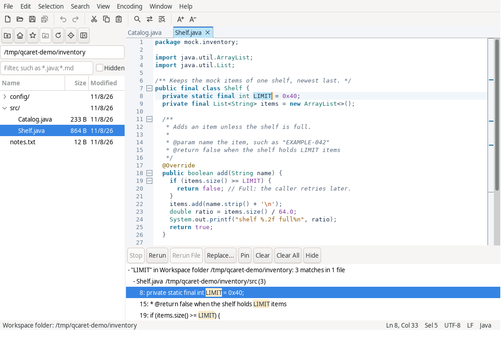

<picture> <source media="(prefers-color-scheme: dark)"
srcset="qcaret-dist/src/icons/qcaret.svg">  </picture>

# QCaret

QCaret is a cross-platform programmer's text editor, written in Java 21 with
SWT. It makes no outbound network connections; its only socket is a loopback
endpoint that passes files from a second launch to the running instance.

QCaret runs no macros, scripts or plugins.

<picture> <source media="(prefers-color-scheme: dark)"
srcset="docs/images/qcaret-dark.png">  </picture>

## Features

| Area | Summary | Guide |
|---|---|---|
| Editing | Tabs with undo and redo, line commands, case and indent commands, Transpose, Delete Word, Wrap Paragraph, word completion, bracket matching, auto-close, smart indent, sort, duplicate removal and trailing-whitespace trim, Insert Date and Time, Document Statistics, read-only documents, a command palette | [Editing](docs/user-guide.md#editing) |
| Carets | Multiple carets and selections (Mod+click, Mod+drag, a key per row, next occurrence, every occurrence, Skip Occurrence), Expand Selection, Select Line, Undo Selection, block selection by Alt+drag or keys, column selection mode | [Multiple carets](docs/user-guide.md#multiple-carets-and-block-selection) |
| Encodings | Detection from the byte order mark, a declaration or the content; Reopen with Encoding and Save with Encoding; line-ending conversion; files that would not write back byte for byte open read-only; binary files open read-only after a prompt | [Encodings](docs/user-guide.md#encodings) |
| Per-file settings | Tab width, indentation, line ending, encoding and Save cleanup from `.editorconfig` files and vim and Emacs modelines | [Per-file settings](docs/user-guide.md#per-file-settings) |
| Editor display | Right margin line, indent guides, modified-line marks against the saved text, word wrap, whitespace and line-ending marks, split views | [Main window](docs/user-guide.md#the-main-window) |
| Syntax highlighting | 35 languages and 12 file formats, user grammars, comment commands, folding by brackets, block keywords, section headers, comments and strings, region markers or indentation | [Syntax highlighting](docs/user-guide.md#syntax-highlighting), [Folding](docs/user-guide.md#folding) |
| Search and HyperSearch | Find bar with incremental find and history; HyperSearch over a document, a selection, the open documents, the workspace folder or a directory tree, into a results dock that keeps ten sets and marks stale matches | [Search](docs/user-guide.md#search-and-hypersearch) |
| Replace across files | Replace in a finished result set with a preview, a report per file, backups and a restore | [Replace](docs/user-guide.md#replace) |
| Bookmarks and navigation | Bookmarks with comments and a Bookmarks list, Go Back and Go Forward, Go to Line, the overview strip | [Bookmarks](docs/user-guide.md#bookmarks), [Main window](docs/user-guide.md#the-main-window) |
| Workspace and Quick Open | A workspace folder per window; a browser that shows any folder, with favorites, a filter, Size and Modified columns, several rows selected at once, drag to open or copy, Search in Folder, New File, New Folder, Rename and Delete; Quick Open over the open documents, the folder's files and Recent Files; Switch Document; Go to Symbol | [Workspace](docs/user-guide.md#workspace), [Quick Open](docs/user-guide.md#quick-open) |
| Checksums | MD5, SHA-1, SHA-256 and SHA-512 of typed text, files or the selection; Verify Checksums over a `sha256sum` list | [Checksums](docs/user-guide.md#checksums) |
| Compare | Side-by-side read-only comparison of two documents, a document and its file, or two files from the command line | [Compare](docs/user-guide.md#compare) |
| Printing | Page ranges, copies, the selection, line numbers and syntax colors, in the background | [Printing](docs/user-guide.md#printing) |
| External changes | Each open file checked on a poll and on window activation; a clean document reloads, a dirty one asks: Keep Mine, Reload or Compare | [External changes](docs/user-guide.md#external-changes) |
| Sessions and recovery | Session restore of windows, tabs, carets, splits, folds, bookmarks and docks; per-file state; recovery files for unsaved buffers after a crash | [Sessions](docs/user-guide.md#sessions-and-recovery) |
| Windows and single instance | Several windows with live tab moves; Always on Top per window; a second launch hands its files to the running instance; file associations | [Windows](docs/user-guide.md#windows-and-the-running-instance) |
| Large files | Loads with progress and Cancel; a file must fit the heap; no file over 2 GiB opens | [Large files](docs/user-guide.md#large-files) |
| Preferences and themes | Preferences applied without a restart, key bindings, editor font, light, dark and system themes, bundled editor color schemes, theme files | [Preferences](docs/user-guide.md#preferences) |
| Help | Keyboard Shortcuts, Command-Line Options, the user guide in its own window, Tip of the Day, Show Log with a warning marker, debug log file, Report an Issue, About and Licenses | [Help](docs/user-guide.md#help-and-logs) |

Every key binding is listed under Help > Keyboard Shortcuts.

## Building

Build with JDK 21 and the Maven wrapper:

```sh
xvfb-run -a -s "-screen 0 1280x1024x24" ./mvnw clean verify
```

CI runs the GUI tests on a 1280x1024 screen; `qcaret-ui-swt/TESTING.md` names
the ones a 640x480 screen fails.

`verify` runs Spotless, Checkstyle, SpotBugs with find-sec-bugs, the ArchUnit
rules and every test, and builds the universal jar and the bundle for the build
host. Fix formatting with `./mvnw spotless:apply`.

| Command | Builds |
|---|---|
| `./mvnw clean verify` | Universal zip and the host target's bundle |
| `./mvnw clean verify -Dqcaret.target=<target>` | Universal zip and that target's bundle; compiles the UI against that target's SWT fragment and skips the `swt` tests |
| `./mvnw clean verify -Pall-targets` | Universal zip and all six bundles |

### GUI tests

Tests tagged `swt` open windows.

| Host | `swt` tests |
|---|---|
| Linux | Run when `DISPLAY` is set, skipped otherwise. Surefire sets `GDK_BACKEND=x11`, so under `xvfb-run` the windows go to Xvfb even in a Wayland session |
| Windows | Always run |
| macOS | Always run, with `-XstartOnFirstThread` |

### Archives

Archives are written to `dist/`, which no build step deletes. They are built on
Linux x86_64 only, because packaging runs `tar`, `jlink`, `jmod`, launch4j's
x86-64 Linux linker and `rcodesign`. On any other host `qcaret-dist` builds and
smoke-tests `qcaret.jar` and writes no archive.

The Temurin JDK archives and `rcodesign` are downloaded once into
`~/.cache/qcaret-build/` (`-Dqcaret.cache.dir` overrides it) and checked
against pinned SHA-256 digests.

Builds are reproducible: with the same JDK, two builds of one commit write
byte-identical jars, `qcaret.exe` and archives, every entry dated
`project.build.outputTimestamp` from the parent POM.
`.github/scripts/check-reproducible.sh` builds twice and compares SHA-256.

### Container build

A host with Docker (or Podman with compose) and no JDK builds in the image
`docker/Dockerfile` defines: Temurin 21, git, Xvfb and GTK 3. `compose.yaml`
holds the mounts and environment and runs the same `./mvnw`.

```sh
scripts/container.sh               # clean package -Pall-targets: seven archives into dist/
scripts/container.sh check         # xvfb-run ./mvnw clean verify at 1280x1024, SWT tests included
scripts/container.sh clean         # ./mvnw clean, and empty dist/
scripts/container.sh shell         # a shell in the build image
scripts/container.sh --rebuild     # rebuild the build image first
scripts/container.sh --out DIR     # write the archives to DIR
scripts/container.sh ./mvnw -B spotless:check
```

- Any other command runs verbatim in the image at the repository root.
- Windows uses `scripts\container.bat` with the same arguments; WSL uses the
  Linux script.
- The output directory is bind-mounted over `dist/`, so `clean` empties it and
  never removes it.
- The Maven repository, the wrapper's Maven and the JDK cache live in the named
  volume `qcaret-maven-repo`.
- On Linux the container runs as the calling user, so files in `dist/` and
  `target/` belong to that user.
- The service is `linux/amd64`, because packaging runs launch4j's x86-64
  linker; an arm64 host runs it under its engine's emulation.

### Continuous integration

`.github/workflows/ci.yml` runs on every push to `main`, every pull request,
every pushed `v*` tag and on demand, with Temurin 21.0.12+8. Actions are pinned
by commit SHA.

| Job | Runners | Does |
|---|---|---|
| `test` | `ubuntu-24.04`, `ubuntu-24.04-arm`, `windows-2025`, `windows-11-arm`, `macos-15-intel`, `macos-15` | `./mvnw -B verify` on each target natively, SWT tests included (Linux under `xvfb-run`) |
| `test-gtk4` | `ubuntu-24.04` | The SWT modules' tests with `SWT_GTK4=1`; gating, with a test that hits a known SWT GTK 4 defect skipped there and the issue named |
| `test-ibus` | `ubuntu-24.04` | `IBusCompositionTest` with `-Dqcaret.ibus.required=true`: a real IBus engine through GTK 3 ([qcaret-ui-swt testing](qcaret-ui-swt/TESTING.md#ibus-test)); `continue-on-error`, outside `release` |
| `package` | `ubuntu-24.04` | `./mvnw -B package -Pall-targets,sbom`; uploads the seven archives and the SBOM as `qcaret-archives`, kept 90 days for a tag and 14 otherwise |
| `bundle` | the six `test` runners | Unpacks the target's bundle, checks the runtime's `os.arch`, and starts the bundle's launcher until the main window opens; then starts the universal zip's launcher, which has no runtime, with setup-java's JDK |
| `release` | `ubuntu-24.04` | `v*` tags only, after every `test`, `test-gtk4` and `bundle` job passes: runs `check-reproducible.sh`, writes `SHA256SUMS` over the `package` job's archives, checks the rebuild against it, and creates a draft GitHub Release |

On Windows the `bundle` job starts `qcaret.exe`, finds the `javaw.exe` child
running `qcaret.jar`, and passes only when the child's image is the bundle's
`runtime\bin\javaw.exe` with the target's PE machine type (`ARM64` on
`windows-11-arm`); the universal zip's `qcaret.exe` must start the JDK's
`javaw.exe`. On macOS it also runs `codesign --verify --deep --strict` on
`QCaret.app`.

The `package` job caches the JDK archives and `rcodesign` under
`~/.cache/qcaret-build`, apart from the Maven cache, keyed on
`qcaret-dist/src/build/dist.xml`; the `release` job shares that cache.

#### Releases

The draft Release carries the seven archives the `bundle` jobs ran,
`SHA256SUMS` and `qcaret-<version>-sbom.cdx.json`, with GitHub's generated
release notes. Only the `release` job has `contents: write`. To release:

1. Push the tag: `git tag v<version> && git push origin v<version>`.
2. Review the draft on the repository's Releases page.
3. Publish it there, or with `gh release edit v<version> --draft=false`.

To fix a bad draft, delete the draft and the tag
(`gh release delete v<version> --cleanup-tag`) and tag again.

#### Dependencies

- `-Psbom` writes the CycloneDX SBOM to `dist/`: every compile and runtime
  dependency of the shipped modules, plus the six SWT fragments `qcaret.jar`
  carries. It leaves out build-only tools, `qcaret-bench`, the Temurin runtimes
  and launch4j's header.
- `.github/workflows/dependency-check.yml` scans the dependencies for known
  vulnerabilities weekly.
- Dependabot proposes Maven and Actions updates.

## Targets

| Target | SWT fragment | Bundle |
|---|---|---|
| linux-x86_64 | `gtk.linux.x86_64` | `qcaret-<version>-linux-x86_64.tar.gz` |
| linux-aarch64 | `gtk.linux.aarch64` | `qcaret-<version>-linux-aarch64.tar.gz` |
| windows-x86_64 | `win32.win32.x86_64` | `qcaret-<version>-windows-x86_64.zip` |
| windows-aarch64 | `win32.win32.aarch64` | `qcaret-<version>-windows-aarch64.zip` |
| macos-x86_64 | `cocoa.macosx.x86_64` | `qcaret-<version>-macos-x86_64.zip` (`QCaret.app`) |
| macos-aarch64 | `cocoa.macosx.aarch64` | `qcaret-<version>-macos-aarch64.zip` (`QCaret.app`) |

- `qcaret-<version>.zip` holds the universal `lib/qcaret.jar`, which runs on
  all six targets under an installed Java 21, with `bin/qcaret` and
  `qcaret.exe`.
- Each bundle adds a Java runtime for its target, so it needs no installed
  Java.
- Linux targets need the system GTK 3 libraries. GTK 4 is an experimental
  opt-in on linux-x86_64: start QCaret with `SWT_GTK4=1` (GTK 4 libraries
  required). Under GTK 4 Help > User Guide shows no guide window; a notice
  names the guide's file instead.
- The macOS bundles are ad-hoc signed and not notarized, so macOS asks the user
  to approve the first launch.
- File associations: on Linux run `bin/install-desktop-entry`, on Windows
  `register-associations.cmd`, each per user; the macOS bundle declares its
  document types. Details are in
  [qcaret-dist](qcaret-dist/README.md#file-associations).

## Command line

```text
qcaret [options] [[+<line>[:<column>]] file]...
java -jar qcaret.jar [options] [[+<line>[:<column>]] file]...
```

| Option | Effect |
|---|---|
| `-h`, `--help` | Print usage and exit 0 |
| `-v`, `--version` | Print `qcaret <version>` and exit 0 |
| `-d`, `--debug <level>` | stderr log level: `1` INFO, `2` DEBUG, `3` and above TRACE, or `error`, `warn`, `info`, `debug`, `trace`; WARN when absent. Show Log (INFO) and the `-l` file (DEBUG) take it when finer. It applies to QCaret's own loggers; the Java runtime's stay at INFO |
| `-l`, `--log` | Also write the log at DEBUG to `logs/qcaret.log` in the settings directory, for this run; a process other than the running instance writes `logs/qcaret-<pid>.log` |
| `-m`, `--multi` | Run as an independent instance: no handoff, no session, and the window placement is not saved |
| `-n`, `--new-window` | Open in a new window of the running instance, placed by any `--window-*` option; cannot be combined with `-m` |
| `-r`, `--read-only` | Open the following files read-only; also applies to a file already open |
| `-e`, `--encoding <name>` | Open the following files in this encoding; a file already open keeps its own |
| `+<line>[:<column>]` | Place the caret in the next file, counting from 1; also applies to a file already open |
| `--session`, `--no-session` | Restore the previous session, or skip it; by default it restores when no file is given. A launch that hands off to a running instance ignores both |
| `--diff <a> <b>` | Open the read-only comparison of two files |
| `--window-width <px>`, `--window-height <px>` | Client-area size, each independently; overrides the remembered size for this run and is not saved back; default 1024 x 768 |
| `--window-x <px>`, `--window-y <px>` | Window position, as above; ignored on Wayland, where the compositor places windows |
| `--settings <dir>` | Settings directory, created owner-only; holds `qcaret.conf` and QCaret's SWT native cache |
| `--` | End of options |
| `file` | Opened in a tab; a missing file opens an empty document that saves to that path. Without a file, an untitled document opens |

Options combine: `-ml`, `--opt=value`, `-d2`. An unknown option or a bad value
prints a message to stderr and exits 1; a Java older than 21 or an unsupported
platform exits 2; an SWT start failure, such as missing GTK libraries, exits 3.
After `--`, a `+<line>` is a file name.

Without `-m`, a launch hands its files to the instance running on the same
settings directory and exits 0; any failure opens the files in the launch's own
window. A file another window holds selects that tab, so an instance holds one
buffer per file.

## Settings directory

QCaret keeps its files in the first directory that applies:

| Mode | When | Directory |
|---|---|---|
| Explicit | `--settings <dir>` | `<dir>` |
| Portable | `qcaret.conf` exists in the installation directory, the parent of `lib/` | The installation directory |
| Portable (Linux) | `qcaret.conf` exists beside the `bin/qcaret` script and not in the installation directory | `bin/` |
| Per-user | Otherwise | Linux `$XDG_CONFIG_HOME/qcaret` (default `~/.config/qcaret`), Windows `%APPDATA%\QCaret`, macOS `~/Library/Application Support/QCaret` |

An empty `qcaret.conf` in either place selects portable mode. The
macOS bundle is sealed, so portable use there goes through `--settings`.

| File | Contents |
|---|---|
| `qcaret.conf` | Settings (Java properties, `version=1`); the keys are in [qcaret-app settings](qcaret-app/docs/settings.md#keys) |
| `qcaret_session.conf` | The session: each window's tabs and docks, Recent Files, the state of the last 500 files |
| `recovery/` | Recovery files of unsaved buffers, one directory per running instance |
| `snapshot/` | Unsaved buffers a quit wrote when Quit without asking is on |
| `instance.lock`, `instance.endpoint` | Single-instance lock and handoff endpoint |
| `qcaret_session.lock` | Held by the instance that restores and saves the session |
| `logs/` | Debug log files |
| `cache/` | The user guide's copy; with `--settings` or in portable mode, the SWT natives; on Windows, the guide browser's data in `cache\webview2` |
| `grammars/` | User grammars |
| `themes/` | Theme files |
| `replace-backups/` | Original bytes of the files a replace run rewrote |

- In explicit and portable mode on Linux, `user.home` is the settings
  directory, so GTK's `.swt/trims.prefs` lands there too, and User Guide opens
  in the system's HTML application, since WebKitGTK writes under the home
  directory. The one write outside is an empty `~/.config/ibus/bus` from the
  GTK input method module.
- On Linux and macOS a launch hands its files over only when the settings
  directory belongs to the current user and no one else can write it; otherwise
  every launch opens its own window.

## Layout

| Path | Contents |
|---|---|
| `qcaret-bootstrap/` | Entry point of `qcaret.jar`: Java version check, target selection, SWT natives, nested-jar class loader |
| `qcaret-core/` | Threads and the heap budget, paths and safe saves, encodings, the rope storage and the document model, grammars and the tokenizer, search; no SWT, no logging dependency |
| `qcaret-app/` | Command line, commands and menus, controllers, the display projection, view contracts, settings, theme, About facts; no SWT |
| `qcaret-ui-swt/` | SWT views: main window and tabs, the editor over `StyledText`, dialogs, theme service; the main toolbar and its icon set (`src/icons/*.svg`), rendered to PNG at build time |
| `qcaret-launcher/` | Composition, logging configuration, architecture rules |
| `qcaret-dist/` | Universal jar, launchers, runtimes and archives; icons |
| `qcaret-bench/` | Benchmarks; not shipped |
| `config/` | Checkstyle, SpotBugs and find-sec-bugs configuration |
| `docker/`, `compose.yaml`, `scripts/` | Container build |
| `.github/` | CI workflows, Dependabot and the scripts the CI steps run |
| `tools/icons.sh` | Renders the application icon from `qcaret-dist/src/icons/*.svg` |
| `docs/user-guide.md`, `docs/images/guide/` | The user guide; the build converts it to the page Help > User Guide shows |
| `tools/screenshots.sh`, `docs/images/` | Writes the light and dark screenshots and the user guide's images under Xvfb from generated mock files |

## Documents

| Document | Covers |
|---|---|
| `<module>/README.md` | The module's packages, contracts and links to its topic documents under `<module>/docs/` |
| `qcaret-core/TESTING.md`, `qcaret-app/TESTING.md`, `qcaret-ui-swt/TESTING.md` | Test harness and coverage by class |
| `docs/user-guide.md` | The user guide |
| `NOTICE`, `qcaret-dist/src/dist/THIRD-PARTY.txt` | Licenses of shipped components |
