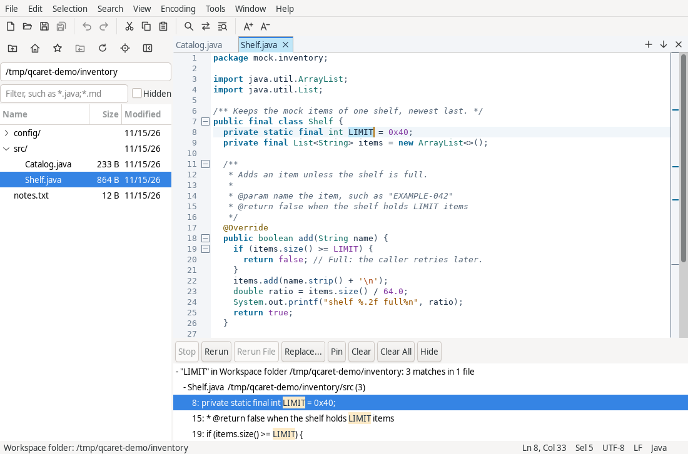

<picture> <source media="(prefers-color-scheme: dark)"
srcset="qcaret-dist/src/icons/qcaret.svg">  </picture>

# QCaret

[](https://github.com/ajdailey/qcaret/actions/workflows/ci.yml)
[](https://github.com/ajdailey/qcaret/releases/latest)
[](LICENSE)
[](https://github.com/ajdailey/qcaret/releases/tag/continuous)

QCaret is a cross-platform programmer's text editor, written in Java 21 with
SWT. It has no telemetry or account, never checks for updates on its own (Help
> Check for Updates opens the releases page in the browser), and needs no
network to run; its only socket is a loopback endpoint that passes files from a
second launch to the running instance. The optional Browser Markdown preview
uses the system web engine (WebKitGTK, WebView2, WebKit) and loads no remote
content.

QCaret runs no macros, scripts or plugins.

<picture> <source media="(prefers-color-scheme: dark)"
srcset="docs/images/qcaret-dark.png">  </picture>

## Features

| Area | Summary | Guide |
|---|---|---|
| Editing | Tabs with undo and redo, line commands, case and indent commands, Transpose, Delete Word, Wrap Paragraph, word completion, bracket matching, auto-close, smart indent, sort (also numeric), duplicate and blank line removal, reverse, whitespace trims, indentation conversion, Encode/Decode Text (Base64, URL, XML entities, JSON strings), Insert Date and Time, Insert Number Sequence, Document Statistics, read-only documents, a command palette, context menus | [Editing](docs/user-guide.md#editing) |
| XML and JSON | Pretty Print, Minify and Check Well-Formed of a selection or the document, JSON comments kept unless Strict JSON is on, Copy XML Path and Copy JSON Path | [Formatting XML and JSON](docs/user-guide.md#formatting-xml-and-json) |
| Carets | Multiple carets and selections (Mod+click, Mod+drag, a key per row, next occurrence, every occurrence, Skip Occurrence), Expand Selection, Select Line, Undo Selection, block selection by Alt+drag or keys, column selection mode | [Multiple carets](docs/user-guide.md#multiple-carets-and-block-selection) |
| Encodings | Detection from the byte order mark, a declaration or the content; Reopen with Encoding and Save with Encoding; line-ending conversion, also from the status bar; files that would not write back byte for byte open read-only; binary files open read-only after a prompt | [Encodings](docs/user-guide.md#encodings) |
| Per-file settings | Tab width, indentation, line ending, encoding and Save cleanup from `.editorconfig` files and vim and Emacs modelines | [Per-file settings](docs/user-guide.md#per-file-settings) |
| Editor display | Right margin line, indent guides, modified-line marks against the saved text, word wrap, whitespace and line-ending marks, split views | [Main window](docs/user-guide.md#the-main-window) |
| Syntax highlighting | 35 languages and 12 file formats, user grammars, comment commands, folding by brackets, block keywords, section headers, comments and strings, region markers or indentation | [Syntax highlighting](docs/user-guide.md#syntax-highlighting), [Folding](docs/user-guide.md#folding) |
| Markdown preview | Source, Split and Preview per tab; Basic and Browser renderers, tables fitted to the pane, Sync Scrolling, an Outline dock, a zoom of its own, Export as HTML, Print Rendered Markdown; a web link asks before it opens | [Markdown preview](docs/user-guide.md#markdown-preview) |
| Search and HyperSearch | Find bar with incremental find and history; HyperSearch over a document, a selection, the open documents, the workspace folder or a directory tree, into a results dock that keeps ten sets, marks stale matches and copies matches as `path:line: text` | [Search](docs/user-guide.md#search-and-hypersearch) |
| Replace across files | Replace in a finished result set with a preview, a report per file, backups and a restore | [Replace](docs/user-guide.md#replace) |
| Bookmarks and navigation | Bookmarks with comments and a Bookmarks list, Go Back and Go Forward, Go to Line, the overview strip | [Bookmarks](docs/user-guide.md#bookmarks), [Main window](docs/user-guide.md#the-main-window) |
| Workspace and Quick Open | A workspace folder per window; a browser that shows any folder, with favorites, a filter, Size and Modified columns, several rows selected at once, drag to open or copy, Search in Folder, New File, New Folder, Rename and Delete; Quick Open over the open documents, the folder's files and Recent Files; Switch Document; Go to Symbol; Open Path at Caret, honoring a `:line` suffix | [Workspace](docs/user-guide.md#workspace), [Quick Open](docs/user-guide.md#quick-open), [Opening files](docs/user-guide.md#opening-files) |
| Checksums | MD5, SHA-1, SHA-256 and SHA-512 of typed text, files or the selection; Verify Checksums over a `sha256sum` list | [Checksums](docs/user-guide.md#checksums) |
| Compare | Side-by-side read-only comparison of two documents, a document and its file, or two files from the command line | [Compare](docs/user-guide.md#compare) |
| Printing | Page ranges, copies, the selection, line numbers and syntax colors, in the background | [Printing](docs/user-guide.md#printing) |
| External changes | Each open file checked on a poll and on window activation; a clean document reloads, a dirty one asks: Keep Mine, Reload or Compare | [External changes](docs/user-guide.md#external-changes) |
| Sessions and recovery | Session restore of windows, tabs, carets, splits, folds, bookmarks and docks; per-file state; recovery files for unsaved buffers after a crash | [Sessions](docs/user-guide.md#sessions-and-recovery) |
| Windows and single instance | Several windows with live tab moves; Always on Top per window; Full Screen; a second launch hands its files to the running instance; file associations | [Windows](docs/user-guide.md#windows-and-the-running-instance) |
| Large files | Loads with progress and Cancel; a file must fit the heap; no file over 2 GiB opens; a status bar memory indicator | [Large files](docs/user-guide.md#large-files) |
| Preferences and themes | Preferences applied without a restart, key bindings, editor font, light, dark and system themes, bundled editor color schemes, theme files | [Preferences](docs/user-guide.md#preferences) |
| Help | Keyboard Shortcuts, Command-Line Options, the user guide in its own window, Tip of the Day, Show Log with a warning marker, debug log file, Report an Issue, Check for Updates (opens the releases page), About and Licenses | [Help](docs/user-guide.md#help-and-logs) |

Every key binding is listed under Help > Keyboard Shortcuts.

## Building

Build with JDK 21 and the Maven wrapper:

```sh
xvfb-run -a -s "-screen 0 1280x1024x24" ./mvnw clean verify
```

CI runs the GUI tests on a 1280x1024 screen; `qcaret-ui-swt/TESTING.md` names
the ones a 640x480 screen fails.

`verify` runs Spotless, Checkstyle, SpotBugs with find-sec-bugs, the ArchUnit
rules and every test, and builds the universal jar and the bundle for the build
host. Fix formatting with `./mvnw spotless:apply`. Archives are built on Linux
x86_64 only; on any other host each command below builds `qcaret.jar` alone
([Archives](#archives)).

| Command | Builds |
|---|---|
| `./mvnw clean verify` | Universal zip and the host target's bundle |
| `./mvnw clean verify -Dqcaret.target=<target>` | Universal zip and that target's bundle; compiles the UI against that target's SWT fragment and skips the `swt` tests |
| `./mvnw clean verify -Pall-targets` | Universal zip and all six bundles |

### GUI tests

Tests tagged `swt` open windows.

| Host | `swt` tests |
|---|---|
| Linux | Run when `DISPLAY` is set, skipped otherwise. Surefire sets `GDK_BACKEND=x11`, so under `xvfb-run` the windows go to Xvfb even in a Wayland session |
| Windows | Always run |
| macOS | Always run, with `-XstartOnFirstThread` |

### Archives

Archives, installers and packages are written to `dist/`, which no build step
deletes. They are built on Linux x86_64 only, because packaging runs `tar`,
`jlink`, `jmod`, launch4j's x86-64 Linux linker, `rcodesign`, `nfpm`, and
`makensis` unpacked from Ubuntu's `nsis` packages with `dpkg-deb`. On any other
host `qcaret-dist` builds and smoke-tests `qcaret.jar` and writes no archive.

The Temurin JDK archives, `rcodesign`, `nfpm` and the `nsis` packages are
downloaded once into `~/.cache/qcaret-build/` (`-Dqcaret.cache.dir` overrides
it) and checked against pinned SHA-256 digests.

Builds are reproducible: with the same JDK (CI's Temurin 21.0.13.1+2), two
builds of one commit write byte-identical jars, `qcaret.exe`, archives,
installers and packages, every entry dated `project.build.outputTimestamp`
from the parent POM.
`.github/scripts/check-reproducible.sh` builds twice and compares SHA-256.

### Container build

A host with Docker (or Podman with compose) and no JDK builds in the image
`docker/Dockerfile` defines: Temurin 21, git, Xvfb and GTK 3. `compose.yaml`
holds the mounts and environment and runs the same `./mvnw`.

```sh
scripts/container.sh               # clean package -Pall-targets: archives, installers, packages into dist/
scripts/container.sh check         # xvfb-run ./mvnw clean verify at 1280x1024, SWT tests included
scripts/container.sh clean         # ./mvnw clean, and empty dist/
scripts/container.sh shell         # a shell in the build image
scripts/container.sh --rebuild     # rebuild the build image first
scripts/container.sh --out DIR     # write the archives to DIR
scripts/container.sh ./mvnw -B spotless:check
```

- Any other command runs verbatim in the image at the repository root.
- Windows uses `scripts\container.bat` with the same arguments; WSL uses the
  Linux script.
- The output directory is bind-mounted over `dist/`, so `clean` empties it and
  never removes it.
- The Maven repository, the wrapper's Maven and the JDK cache live in the named
  volume `qcaret-maven-repo`.
- On Linux the container runs as the calling user, so files in `dist/` and
  `target/` belong to that user.
- The service is `linux/amd64`, because packaging runs launch4j's x86-64
  linker; an arm64 host runs it under its engine's emulation.

### Continuous integration

`.github/workflows/ci.yml` runs on every push to `main`, every pull request,
every pushed `v*` tag and on demand, with Temurin 21.0.13.1+2 (21.0.12.1+1 on
windows-aarch64). Actions are pinned by commit SHA, and every checkout sets
`persist-credentials: false`. Linux jobs install Xvfb and GTK 3 from the Ubuntu
archive when the runner image lacks them.

| Job | Runners | Does |
|---|---|---|
| `test` | `ubuntu-24.04`, `ubuntu-24.04-arm`, `windows-2025`, `windows-11-arm`, `macos-15-intel`, `macos-15` | `./mvnw -B verify` on each target natively, SWT tests included (Linux under `xvfb-run`); Linux installs `libwebkit2gtk-4.1-0` for the Browser preview tests |
| `test-gtk4` | `ubuntu-24.04` | `verify` of `qcaret-ui-swt`, `qcaret-launcher`, `qcaret-dist` (the distribution tests) and the modules they need, with `SWT_GTK4=1`; gating, with a test that hits a known SWT GTK 4 defect skipped there and the issue named |
| `test-ibus` | `ubuntu-24.04` | `IBusCompositionTest` with `-Dqcaret.ibus.required=true`: a real IBus engine through GTK 3 ([qcaret-ui-swt testing](qcaret-ui-swt/TESTING.md#ibus-test)); `continue-on-error`, outside `release` |
| `package` | `ubuntu-24.04` | `./mvnw -B package -Pall-targets,sbom -DskipTests org.cyclonedx:cyclonedx-maven-plugin:makeAggregateBom -Drevision=<version>`, then `sbom-components.sh`; uploads the seven archives, two Windows installers, four Linux packages and the SBOM as `qcaret-archives`, kept 90 days for a tag and 14 otherwise |
| `bundle` | the six `test` runners | Unpacks the target's bundle, checks that a Linux or Windows archive holds `portable.txt` and no `qcaret.conf`, checks the runtime's `os.arch`, and starts the bundle's launcher until the main window opens; then starts the universal zip's launcher, which has no runtime, with setup-java's JDK. Linux and Windows runners then check the target's packages or setup |
| `release` | `ubuntu-24.04` | `v*` tags only, after every `test`, `test-gtk4` and `bundle` job passes: fails unless the tag is `v` plus `<revision>` without `-SNAPSHOT`, optionally followed by `-rc<N>`, runs `check-reproducible.sh` with the tag's `-Drevision`, writes `SHA256SUMS` over the `package` job's 13 archives, installers and packages, checks the rebuild against it, and creates a draft GitHub Release, marked pre-release when the tag has a suffix (`v0.2.0-rc1`) |
| `continuous` | `ubuntu-24.04` | Pushes to `main` only, after the same jobs as `release`: writes `SHA256SUMS` over the `package` job's archives and runs `publish-continuous.sh`, which replaces the `continuous` pre-release with them, the SBOM and `SHA256SUMS` and moves the `continuous` tag to the commit |

On Windows the `bundle` job starts `qcaret.exe`, finds the `javaw.exe` child
running `qcaret.jar`, and passes only when the child's image is the bundle's
`runtime\bin\javaw.exe` with the target's PE machine type (`ARM64` on
`windows-11-arm`); the universal zip's `qcaret.exe` must start the JDK's
`javaw.exe`. Each launch repeats through `qcaret.cmd`, and `qcaret.cmd` runs
over a probe jar from folders whose names hold a space, `&` and `%` to check
the Java it picks, the JVM options and each argument, then passes unquoted
`&`, `^`, `!` and `%` names the way Explorer drops them, and escaped ones from a
command prompt, and fails if any name changes or a command in one runs. A CJK
file name beside a decoy then goes through both launchers, and the job fails if
the decoy opens or the launch neither opens the name nor shows its message. On
macOS it also runs
`codesign --verify --deep --strict` on `QCaret.app`.

Linux runners then install the `.deb` with `apt`, check its files, desktop
entry and icons, run the same launch against `/opt/qcaret` through
`/usr/bin/qcaret` with the main window's `WM_CLASS` checked against
`StartupWMClass`, remove it, and install, verify (`rpm -V`), run `qcaret -v`
and remove the `.rpm` in a Fedora 44 container. Windows runners walk the
setup's pages and upload each as a PNG (`installer-screenshots-<target>`),
check that the finish page starts QCaret through Explorer, then install
silently for all users and for the current user, check the Installed apps
entry, shortcut and Open With, run the same launch checks against the
installed folder, install over it, uninstall and check removal; then a
portable install, an install over it, and three refused folders. Details are in
[qcaret-dist](qcaret-dist/README.md#ci-bundle-check).

The `package` job caches the JDK archives, `rcodesign`, `nfpm` and NSIS under
`~/.cache/qcaret-build`, apart from the Maven cache, keyed on
`qcaret-dist/src/build/dist.xml`; the `release` job shares that cache. Only the
`test` jobs save the Maven cache; `test-gtk4`, `test-ibus`, `package` and
`release` restore it, since a cache saved by a job that skips `verify` or builds
part of the reactor would lack plugins and send every later job to Maven Central
for them.

#### Releases

The draft Release carries the archives, installers and packages the `bundle`
jobs ran, `SHA256SUMS` and `qcaret-<version>-sbom.cdx.json`, with GitHub's generated
release notes. A tag with a suffix (`v0.2.0-rc1`) drafts a pre-release, which
never becomes the repository's latest release. Only the `release` and
`continuous` jobs have `contents: write`.

The [`continuous`](https://github.com/ajdailey/qcaret/releases/tag/continuous)
pre-release holds the build of the newest `main` commit whose CI run passed,
never marked Latest; its body names the commit, the run and the date.

Every module's version is `${revision}`, set once in the parent POM
(`<revision>0.2.0-SNAPSHOT</revision>`), so a version change is that one line;
flatten-maven-plugin writes the resolved POM into each jar. The `package` job
builds with `-Drevision`: the tag's version for a `v*` tag, otherwise
`<revision>+<short commit>` (for example `0.2.0-SNAPSHOT+3290f82`), which the
archive names, `Implementation-Version`, `qcaret.exe`'s version text and `-v`
carry. A local build without `-Drevision` uses `<revision>`.

Publishes run one at a time, and `publish-continuous.sh` skips a commit older
than the one `continuous` holds unless it is the `main` head (a force push), so
a re-run of an older run never replaces a newer build.

To release:

1. Set `project.build.outputTimestamp` to the release date and commit; the tag
   goes on that commit, whose `<revision>` stays `<version>-SNAPSHOT`. After
   the release, set `<revision>` to the next `-SNAPSHOT` version.
2. Check the bundled Temurin build (`jdk.*` in `qcaret-dist/src/build/dist.xml`)
   against the latest Oracle Critical Patch Update and the OpenJDK advisories;
   move the pins if a fixed build exists.
3. Push an annotated tag. A release candidate adds `-rc<N>` to the tag
   (`v0.2.0-rc1`) on the same `-SNAPSHOT` commit; its archives carry the
   tag's version.

   ```sh
   git tag -a v<version> -m "QCaret <version>" && git push origin v<version>
   ```

4. Review the draft on the repository's Releases page.
5. Replace the generated notes with the hand-written release notes:

   ```sh
   gh release edit v<version> --notes-file <notes>.md
   ```

6. Publish the draft on the Releases page, or with `gh release edit v<version>
   --draft=false`.

To fix a bad draft, delete the draft and the tag
(`gh release delete v<version> --cleanup-tag`) and tag again.

#### Dependencies

- `package -Psbom org.cyclonedx:cyclonedx-maven-plugin:makeAggregateBom`
  writes the CycloneDX SBOM to `dist/`: the shipped modules and every compile
  and runtime dependency, plus the six SWT fragments `qcaret.jar` carries. It
  leaves out build-only tools and `qcaret-bench`. The goal is named by its
  plugin coordinates: a `cyclonedx:` prefix makes Maven look the prefix up on
  Central.
  `.github/scripts/sbom-components.sh`, run by the `package` job, adds the
  Temurin releases `dist.xml` downloads and launch4j's header.
- `.mvn/maven.config` sets `--strict-checksums` and a resolver filter that
  admits only the `central` repository, so a repository a third-party POM
  declares is never contacted. A settings mirror replaces `central` with its
  own id; a build through one adds
  `-Daether.remoteRepositoryFilter.groupId.noInputOutcome.<mirror-id>=true`.
  It also retries an HTTP 429 or 503 from the repository 8 times, starting 10
  seconds apart: Maven Central rate-limits GitHub runners.
- The `bannedDependencies` enforcer rule fails the build when the SWT host
  artifact `org.eclipse.platform:org.eclipse.swt` reaches a module: its
  OS-activated profiles add the build host's fragment, a second SWT on the
  class path.
- `.github/workflows/dependency-check.yml` scans the dependencies for known
  vulnerabilities weekly and on demand, failing on CVSS 7 or higher. It reads
  the NVD API key from the optional `NVD_API_KEY` repository secret and
  reviewed false positives from `config/dependency-check-suppressions.xml`.
- `.github/workflows/sign-check.yml`, run by hand, signs `qcaret.exe` from the
  `continuous` Windows x86_64 zip through Azure Artifact Signing and checks the
  signature on a Windows runner; it publishes nothing. It runs in the `signing`
  environment (branch `main` and tags `v*` only), whose variables name the
  Azure tenant, client, endpoint, account and certificate profile; the login
  uses GitHub's OIDC token, so the repository stores no Azure secret.
- Dependabot proposes Maven, Actions and build image updates.

## Targets

| Target | SWT fragment | Bundle | Installer or package |
|---|---|---|---|
| linux-x86_64 | `gtk.linux.x86_64` | `qcaret-<version>-linux-x86_64-portable.tar.gz` | `qcaret-<version>-linux-x86_64.deb`, `.rpm` |
| linux-aarch64 | `gtk.linux.aarch64` | `qcaret-<version>-linux-aarch64-portable.tar.gz` | `qcaret-<version>-linux-aarch64.deb`, `.rpm` |
| windows-x86_64 | `win32.win32.x86_64` | `qcaret-<version>-windows-x86_64-portable.zip` | `qcaret-<version>-windows-x86_64-setup.exe` |
| windows-aarch64 | `win32.win32.aarch64` | `qcaret-<version>-windows-aarch64-portable.zip` | `qcaret-<version>-windows-aarch64-setup.exe` |
| macos-x86_64 | `cocoa.macosx.x86_64` | `qcaret-<version>-macos-x86_64.zip` (`QCaret.app`) | None |
| macos-aarch64 | `cocoa.macosx.aarch64` | `qcaret-<version>-macos-aarch64.zip` (`QCaret.app`) | None |

- `qcaret-<version>.zip` holds the universal `lib/qcaret.jar`, which runs on
  all six targets under an installed Java 21, with `bin/qcaret`, `qcaret.exe`
  and `qcaret.cmd`.
- Each bundle adds a Java runtime for its target, so it needs no installed
  Java. The Linux and Windows bundles hold `portable.txt` and run in
  [portable mode](#settings-directory); the universal zip and the macOS
  bundles hold no marker.
- Linux targets need the system GTK 3 libraries. GTK 4 is an experimental
  opt-in on linux-x86_64: start QCaret with `bin/qcaret --gtk4` or
  `SWT_GTK4=1`; without the GTK 4 libraries it starts on GTK 3 and logs a warning. Under GTK 4 Help > User Guide shows no guide window; a notice
  names the guide's file instead.
- On Windows, `qcaret.cmd` is a second launcher beside `qcaret.exe`. It passes
  file names dropped on it or typed after it to QCaret as given, `&`, `^`, `%`
  and `!` included, and runs nothing in them. It also passes names outside the
  Windows code page for non-Unicode programs, which `qcaret.exe` delivers with
  `?` or a look-alike character; limits are in
  [qcaret-dist](qcaret-dist/README.md#launchers).
- The Windows launchers and the macOS bundles are not signed by a publisher; see
  [First launch of an unsigned build](#first-launch-of-an-unsigned-build).
- File associations: on Linux run `bin/install-desktop-entry`, on Windows
  `register-associations.cmd`, each per user; the macOS bundle declares its
  document types; the installers and packages register them. Details are in
  [qcaret-dist](qcaret-dist/README.md#file-associations).

### Installing

The installers and packages hold the same tree as the target's bundle.

| Download | Installs |
|---|---|
| `.deb` (Debian, Ubuntu), `.rpm` (Fedora, RHEL) | `/opt/qcaret`, `/usr/bin/qcaret`, a desktop entry with the icon at every size, and Open With for the text and source types its `MimeType` lists. Needs GTK 3: `libgtk-3-0t64` or `libgtk-3-0`, or `gtk3`. Removing the package removes them and keeps the settings in `~/.config/qcaret` |
| `-setup.exe`, for all users | `C:\Program Files\QCaret`, with administrator rights |
| `-setup.exe`, for me only | `%LOCALAPPDATA%\Programs\QCaret` |
| `-setup.exe`, portable | A folder you choose and can write to, outside Program Files and Windows, with `portable.txt`, so the settings stay in that folder. Nothing is registered with Windows; delete the folder to remove it |

The all-users and current-user installs add a Start menu shortcut, Open With
for the extensions `register-associations.cmd` lists (never the default
program) and an Installed apps entry, and a desktop shortcut when chosen on the
finish page. Uninstalling removes them and keeps the settings in
`%APPDATA%\QCaret`. Running setup again upgrades in place, release candidates
included; over a portable folder it keeps `portable.txt` and the settings. A
regular install refuses a folder holding `portable.txt` or `qcaret.conf`. The
finish page starts QCaret as the signed-in user, without administrator rights.
The pages are shown in the [user guide](docs/user-guide.md#installing).

Silent setup takes `/S` with `/MACHINE`, `/USER` or `/PORTABLE`, `/DESKTOP`
for the desktop shortcut (ignored for portable), and `/D=<folder>` last and
unquoted; `/S` alone installs for the current user. It never starts QCaret. It
exits 2 when the folder is refused and 5 for `/MACHINE` without administrator
rights. `"<folder>\uninstall.exe" /S` uninstalls silently.

Package versions replace `-` with `~`, so `0.2.0-rc1` is `0.2.0~rc1` and sorts
before `0.2.0`.

### First launch of an unsigned build

`qcaret.exe` and the setup carry no Authenticode signature, and `QCaret.app` is
ad-hoc signed and not notarized. A downloaded copy therefore needs one approval:

| Platform | First launch |
|---|---|
| Windows | `qcaret.exe` and the setup: SmartScreen shows "Windows protected your PC"; choose More info, then Run anyway. `qcaret.cmd`: "Open File - Security Warning", "The publisher could not be verified"; choose Run. |
| macOS | macOS refuses the first open. Open System Settings > Privacy & Security and choose Open Anyway for QCaret, or run `xattr -dr com.apple.quarantine QCaret.app` before the first launch. |

On Windows, unblock the downloaded zip before extracting it (Properties,
Unblock, or `Unblock-File`): nothing extracted from it then carries the
internet mark, and neither launcher prompts. Neither leaves a console window
open. Measured on Windows 11 26H2 with SmartScreen at its default and Smart App
Control off.

The prompt follows the download mark (the Windows Mark of the Web, the macOS
quarantine attribute), so a copy without it, such as one from removable media,
shows none. The universal jar needs none: `java -jar lib/qcaret.jar` runs under
an installed, signed Java 21. Each release lists the SHA-256 of every archive
in `SHA256SUMS`.

## Command line

```text
qcaret [options] [[+<line>[:<column>]] file]...
java -jar qcaret.jar [options] [[+<line>[:<column>]] file]...
```

| Option | Effect |
|---|---|
| `-h`, `--help` | Print usage and exit 0 |
| `-v`, `--version` | Print `qcaret <version>` and exit 0 |
| `-d`, `--debug <level>` | stderr log level: `1` INFO, `2` DEBUG, `3` and above TRACE, or `error`, `warn`, `info`, `debug`, `trace`; WARN when absent. Show Log (INFO) and the `-l` file (DEBUG) take it when finer. It applies to QCaret's own loggers; the Java runtime's stay at INFO |
| `-l`, `--log` | Also write the log at DEBUG to `logs/qcaret.log` in the settings directory, for this run; a process other than the running instance writes `logs/qcaret-<pid>.log` |
| `-m`, `--multi` | Run as an independent instance: no handoff, no session, and the window placement is not saved |
| `-n`, `--new-window` | Open in a new window of the running instance, placed by any `--window-*` option; cannot be combined with `-m` |
| `-r`, `--read-only` | Open the following files read-only; also applies to a file already open |
| `-e`, `--encoding <name>` | Open the following files in this encoding; a file already open keeps its own |
| `+<line>[:<column>]` | Place the caret in the next file, counting from 1; also applies to a file already open |
| `file.md#heading` | Place the caret at a Markdown heading, unless `+<line>` is given ([Opening at a heading](docs/user-guide.md#opening-at-a-heading)) |
| `--session`, `--no-session` | Restore the previous session, or skip it; by default every start restores it except `--diff`. A launch that hands off to a running instance ignores both |
| `--diff <a> <b>` | Open the read-only comparison of two files |
| `--window-width <px>`, `--window-height <px>` | Client-area size, each independently; overrides the remembered size for this run and is not saved back; default 1024 x 768 |
| `--window-x <px>`, `--window-y <px>` | Window position, as above; ignored on Wayland, where the compositor places windows, and under GTK 4, which cannot move a window |
| `--settings <dir>` | Settings directory, created owner-only; holds `qcaret.conf` and QCaret's SWT native cache |
| `--gtk4` | `bin/qcaret` only: start on SWT's GTK 4 backend by exporting `SWT_GTK4=1`; dropped before Java starts, so `java -jar`, `qcaret.exe` and `qcaret.cmd` reject it. After `--` it is a file name |
| `--` | End of options |
| `file` | Opened in a tab; a missing file opens an empty document that saves to that path. Without a file, an untitled document opens |

Options combine: `-ml`, `--opt=value`, `-d2`. An unknown option or a bad value
prints a message to stderr and exits 1; a Java older than 21 or an unsupported
platform exits 2; an SWT start failure, such as missing GTK libraries, exits 3;
a quit after an internal error exits 4.
After `--`, a `+<line>` is a file name.

Without `-m`, a launch hands its files to the instance running on the same
settings directory and exits 0; any failure opens the files in the launch's own
window. A file another window holds selects that tab, so an instance holds one
buffer per file.

## Settings directory

QCaret keeps its files in the first directory that applies:

| Mode | When | Directory |
|---|---|---|
| Explicit | `--settings <dir>` | `<dir>` |
| Portable | `portable.txt` or `qcaret.conf` exists in the installation directory, the parent of `lib/` | The installation directory |
| Portable (Linux) | `portable.txt` or `qcaret.conf` exists beside the `bin/qcaret` script, and neither in the installation directory | `bin/` |
| Per-user | Otherwise | Linux `$XDG_CONFIG_HOME/qcaret` (default `~/.config/qcaret`), Windows `%APPDATA%\QCaret`, macOS `~/Library/Application Support/QCaret` |

Either file selects portable mode whatever it holds, so an empty `qcaret.conf`
does too. QCaret writes `qcaret.conf` at its first save; an archive never holds
one, so unpacking a newer archive over a portable folder keeps the settings.
The macOS bundle is sealed, so portable use there goes through `--settings`.

| File | Contents |
|---|---|
| `qcaret.conf` | Settings (Java properties, `version=1`); the keys are in [qcaret-app settings](qcaret-app/docs/settings.md#keys) |
| `qcaret_session.conf` | The session: each window's tabs and docks, Recent Files, the state of the last 500 files |
| `recovery/` | Recovery files of unsaved buffers, one directory per running instance |
| `snapshot/` | Unsaved buffers a quit wrote when Quit without asking is on |
| `instance.lock`, `instance.endpoint` | Single-instance lock and handoff endpoint |
| `qcaret_session.lock` | Held by the instance that restores and saves the session |
| `qcaret_error.flag` | Written by a quit after an internal error; the next start that restores the session skips its windows ([Sessions](docs/user-guide.md#sessions-and-recovery)) |
| `logs/` | Debug log files |
| `cache/` | The user guide's copy; with `--settings` or in portable mode, the SWT natives; on Windows, the guide browser's data in `cache\webview2` |
| `grammars/` | User grammars |
| `themes/` | Theme files |
| `replace-backups/` | Original bytes of the files a replace run rewrote |

- In explicit and portable mode on Linux, `user.home` is the settings
  directory, so GTK's `.swt/trims.prefs` lands there too, and User Guide opens
  in the system's HTML application, since WebKitGTK writes under the home
  directory. The one write outside is an empty `~/.config/ibus/bus` from the
  GTK input method module, unless the Markdown preview uses the Browser
  renderer: it runs WebKitGTK, which writes under the XDG cache and data
  directories.
- On Linux and macOS a launch hands its files over only when the settings
  directory belongs to the current user and no one else can write it; otherwise
  every launch opens its own window.

## Layout

| Path | Contents |
|---|---|
| `qcaret-bootstrap/` | Entry point of `qcaret.jar`: Java version check, target selection, SWT natives, nested-jar class loader |
| `qcaret-core/` | Threads and the heap budget, paths and safe saves, encodings, the rope storage and the document model, grammars and the tokenizer, search, XML and JSON formatting, the Markdown preview model, the line diff, external change detection, the workspace index; no SWT, no logging dependency |
| `qcaret-app/` | Command line, commands and menus, controllers, the display projection, view contracts, settings, theme, About facts; no SWT |
| `qcaret-ui-swt/` | SWT views: main window and tabs, the editor over `StyledText`, dialogs, theme service; the main toolbar and its icon set (`src/icons/*.svg`), rendered to PNG at build time |
| `qcaret-launcher/` | Composition, logging configuration, architecture rules |
| `qcaret-dist/` | Universal jar, launchers, runtimes, archives, Windows installers and Linux packages; icons |
| `qcaret-bench/` | Benchmarks; not shipped |
| `config/` | Checkstyle, SpotBugs, find-sec-bugs and dependency-check configuration |
| `docker/`, `compose.yaml`, `scripts/` | Container build |
| `.github/` | CI workflows, Dependabot and the scripts the CI steps run |
| `tools/icons.sh` | Renders the application icon from `qcaret-dist/src/icons/*.svg` |
| `docs/user-guide.md`, `docs/images/guide/` | The user guide; the build converts it to the page Help > User Guide shows |
| `tools/screenshots.sh`, `docs/images/` | Writes the light and dark screenshots and the user guide's images under Xvfb from generated mock files. `tools/screenshots.sh installer [<run-id>]` runs separately: it needs `gh` and network, and copies the user guide's Windows setup pages from the `installer-screenshots-windows-x86_64` artifact of a CI run, by default the latest successful one on `main` |

## Documents

| Document | Covers |
|---|---|
| `<module>/README.md` | The module's packages, contracts and links to its topic documents under `<module>/docs/` |
| `qcaret-core/TESTING.md`, `qcaret-app/TESTING.md`, `qcaret-ui-swt/TESTING.md` | Test harness and coverage by class |
| `docs/user-guide.md` | The user guide |
| `NOTICE`, `qcaret-dist/src/dist/THIRD-PARTY.txt` | Licenses of shipped components |
