# QCaret User Guide

QCaret is a programmer's text editor. It makes no outbound network
connections; a second launch passes its files to the running instance over a
loopback connection. On macOS, `Ctrl` in this guide is `Cmd` unless a key is named for
macOS; Help > Keyboard Shortcuts lists every key for your platform and Tools >
Preferences, Keys changes them.

- [Opening files](#opening-files)
- [The main window](#the-main-window)
- [Editing](#editing)
- [Multiple carets and block selection](#multiple-carets-and-block-selection)
- [Search and HyperSearch](#search-and-hypersearch)
- [Replace](#replace)
- [Bookmarks](#bookmarks)
- [Folding](#folding)
- [Syntax highlighting](#syntax-highlighting)
- [External changes](#external-changes)
- [Workspace](#workspace)
- [Quick Open](#quick-open)
- [Compare](#compare)
- [Checksums](#checksums)
- [Sessions and recovery](#sessions-and-recovery)
- [Windows and the running instance](#windows-and-the-running-instance)
- [Preferences](#preferences)
- [Help and logs](#help-and-logs)
- [Command line](#command-line)
- [Known issues](#known-issues)

## Opening files

Open files with File > Open (`Ctrl+O`), File > Recent Files (the last 20),
[Quick Open](#quick-open), the workspace browser, the [command
line](#command-line), or by dropping them on the window, where a dropped folder
is ignored; on Linux with GTK 4 (`SWT_GTK4=1`) a file dropped from another
program does not open. Each file opens in its own tab; a file already open
selects its tab, in any window. File > New (`Ctrl+N`) opens an untitled
document. File > Reopen Closed Tab (`Ctrl+Shift+T`) opens the file of the
window's last closed tab again, up to 20 back, where the caret was; File >
Recently Closed lists those files to choose from. Open All in either list opens
every listed file; a missing or unreadable one is skipped and named in the
status bar. A file Open All could not open stays in Recently Closed. Clear
Recent Files empties Recent Files in every window, and Clear Recently Closed
empties the window's Recently Closed. Recent Files > Clean Up
removes the entries whose path holds no file, or holds a folder, and names the
count in the status bar. A file under an unmounted mount point counts as
missing and is removed. A file on a share that cannot be reached, or one access
is denied to, stays listed (not run on Windows).

A load still running after 0.3 seconds shows a row above the status bar with its
progress and Cancel. The window stays usable. Cancel or `Esc` stops every
running load, and no tab opens.

A file that does not open shows a notice with the reason, for example `Cannot
open CON: the path names a Windows device` for a Windows device name such as
`CON` or `nul.txt`. Open Path at Caret, Save, Save As, Save a Copy As, Export
as HTML, a checksum list's Save As and entries, the HyperSearch folder, and the
workspace browser's path field, New File, New Folder and Rename name the same
reason.

File > Reload from Disk reads the selected document's file again. With unsaved
changes it asks first, and Undo brings them back.

File > Open Path at Caret opens the file whose path is at the caret, such as
`src/Main.java` or `C:\work\notes.txt`, and goes to a trailing `:line` or
`:line:column`, or to a Markdown heading after `#` (see [Opening at a
heading](#opening-at-a-heading)). A relative path is read from the document's folder, or from
the workspace folder for an untitled document. A path with spaces needs quotes
around it; otherwise the path ends at a space, a quote or one of
`< > | ( ) [ ] { } , ; = * ?`, and a period or colon ending it is dropped. A
URL is never opened, and a path naming no file shows a notice in the status
bar.

### Encodings

The file's encoding comes from its byte order mark, an XML, HTML or Python
declaration, a modeline or `.editorconfig` file (see [Per-file
settings](#per-file-settings)), or the content; UTF-8 is tried before
windows-1252. windows-1252 reads every byte: 0x81, 0x8D, 0x8F, 0x90 and 0x9D,
which the charset leaves undefined, read as the control characters U+0081,
U+008D, U+008F, U+0090 and U+009D, as web browsers read them, and save back as
the same bytes. Encoding >
Reopen with Encoding reads the file again with another charset, and QCaret
remembers it for that file; its Automatic Detection entry returns the file to
detection. Encoding > Save with Encoding changes what the next
save writes. Encoding > Line Endings converts every line break in one undo step;
a file with mixed endings keeps them until then, and Enter inserts the ending
last converted to.

A new document is UTF-8 with LF line breaks. Preferences, Editor chooses
another encoding and line ending for new documents; they also apply to a file
opened by a name that does not exist yet, to an empty file and to Enter in a
file without line breaks. A forced encoding and `.editorconfig` settings take
precedence.

A file that cannot be written back byte for byte in its encoding opens
read-only with a notice, and Save stays off. Save As writes a converted copy;
turning off Read-Only lets Save convert the file itself. A reload that brings in
such bytes does the same, and a later reload of bytes that write back ends it. A
binary file asks first: Open Read-Only shows it as
ISO-8859-1 text, with editing and saving off.

### Per-file settings

A file takes settings from the `.editorconfig` files in its folder and the
folders above it, up to one with `root = true`, and from vim and Emacs
modelines in its first and last five lines:

| Setting | `.editorconfig` | vim | Emacs |
|---|---|---|---|
| Tab width and indentation | `indent_style`, `indent_size`, `tab_width` | `ts`, `sw`, `sts`, `et`, `noet` | `tab-width`, `indent-tabs-mode` |
| Line ending of a file without line breaks | `end_of_line` | `ff` | a `-unix`, `-dos` or `-mac` coding |
| Encoding | `charset` | `fenc` | `coding` |
| Clean up at Save | `trim_trailing_whitespace`, `insert_final_newline` | none | none |

A modeline wins over `.editorconfig`, and both win over the tab settings
QCaret remembers for the file and over Preferences. An encoding you chose with
Reopen with Encoding or Save with Encoding wins over both, and a byte order mark
wins over a declared encoding; a declared encoding that does not read the file
is skipped. `end_of_line` never converts a file's existing line breaks; use
Encoding > Line Endings for that. Trim and the final newline happen at each Save
as one Undo step, so the file holds what the window shows. An `.editorconfig`
section that is not a valid pattern, or that needs too many steps to match, is
ignored with a warning; the file's other sections still apply.

The tab's tool tip names the files and the modeline a document's settings came
from. Save As to another folder, a rename in the workspace browser, Reload and
Reopen with Encoding read them again. Tools > Preferences, Editor, turns each
source off.

### Saving

Save (`Ctrl+S`), Save As (`Ctrl+Shift+S`) and Save All (`Cmd+Option+S` on macOS,
no default key elsewhere, since AltGr arrives as Ctrl+Alt on Windows) write on a
worker while you keep editing; `Esc` cancels a running save and leaves the file
as it was. A save writes a temporary file and moves it over the target, keeps
the file's permissions and group (on Windows its ACL), and follows a symbolic
link. POSIX ACLs and extended attributes on Linux and macOS are not kept. A file you have
no write permission for is not saved, and a message says so. A file in a folder
you cannot write to is written in place, and so is a file with hard links on
Linux and macOS, which keeps its links; once an in-place write has begun, `Esc`
does not stop it. On Windows a save replaces a hard-linked file and splits the
link: its other names keep the old text. Save As onto a file open
in another tab closes that tab, after asking when the tab has unsaved changes.

File > Save a Copy As writes the current text, unsaved changes included, to
another file and leaves the document as it was: same file, same unsaved
changes, same Undo history. The copy is saved as Save would save it, in the
document's encoding and line endings with the trimming and final newline its
`.editorconfig` asks for, and is added to Recent Files. Choosing the document's
own file, or a hard link of it, saves it. A copy written over a file open in
another tab reaches that tab as a change made by another program. `Esc` cancels
a running copy. Closing the tab, Don't Save and closing the window let it finish and report; Exit waits
for it, and a failed copy stops the Exit. After 30 seconds Exit names each copy
still being written and asks: Quit exits and may leave those files incomplete,
Wait waits another 30 seconds. The tab cannot move to another
window until the copy ends.

### Printing

File > Print opens the system print dialog; it has no default key, because
`Ctrl+P` is Quick Open, and Preferences can assign one. The dialog chooses the
printer, the copies, and all pages, a page range or the selection; with text
selected it opens on the selection. The Windows 11 dialog offers no selection
choice, so there File > Print prints what the dialog shows, all pages or a
range of the whole document.

File > Print Selection, enabled while text is selected, opens the same dialog
and prints only the selection on every platform; a page range counts the
selection's pages. It has no default key either. A job prints
the document as it stood when you chose the command, folded text included and
word wrap ignored: a line wider than the page wraps at the column. Each page
has the file name and Page N of M at the top, line numbers, and Light's syntax
colors on white whatever Editor colors shows, in the editor's font at 10
points. A row above the status bar shows the progress with Cancel, and you can
keep editing. One window runs one print job at a time; closing the window cancels it.
On macOS the dialog's Save as PDF proposes the document's name with `.pdf`.

On Linux with GTK 4 (`SWT_GTK4=1`) the print dialog does not open: File > Print
asks for a PDF file name, proposing the document's name with `.pdf`, and writes
the whole document to it, one copy; File > Print Selection writes the selection
the same way.

### Large files

A file opens only when its memory cost fits the 60% of the Java heap that open
documents share. The cost is 1 byte per file byte when the first 64 KiB are
ASCII and 2 otherwise, plus undo room of the same size, at most 64 MiB. A file
that does not fit is refused unread, and the notice names its size, the memory
it needs and the `-Xmx` value to start with. A file whose text costs more past
its first 64 KiB is refused while it loads when the memory is not there. No
file over 2 GiB opens.

Largest single file that opens with nothing else open, measured on Linux
x86_64 (the non-ASCII text has a CJK char in every line):

| Maximum heap | ASCII text | UTF-8 text with non-ASCII chars |
|---|---|---|
| 512 MiB | 243 MiB | 121 MiB |
| 1 GiB | 550 MiB | 275 MiB |
| 2 GiB | 1.1 GiB | 582 MiB |
| 8 GiB | 2 GiB | 2 GiB |

The launchers set the maximum heap to half of the physical memory. To raise it,
run the jar with the bundle's runtime:
`runtime/bin/java --enable-native-access=ALL-UNNAMED -Xmx8g -jar lib/qcaret.jar`.
On Windows add `-Xmx8g` as a line in `qcaret.l4j.ini` next to `qcaret.exe`;
`qcaret.cmd` does not read that file, so replace `-XX:MaxRAMPercentage=50` in
`qcaret.cmd` with `-Xmx8g`. On
macOS the runtime and jar sit inside the bundle, and `-XstartOnFirstThread` is
required, since without it QCaret restarts Java and drops `-Xmx8g` (not run on
macOS):
`QCaret.app/Contents/runtime/Contents/Home/bin/java -XstartOnFirstThread --enable-native-access=ALL-UNNAMED -Xmx8g -jar QCaret.app/Contents/app/lib/qcaret.jar`.

After a file of 500,000 lines or more is read, the window pauses once while the
editor takes its lines: the status bar shows
`Preparing <name> for display: <n> lines` and the busy cursor until the editor
shows.

A reload holds only the text between the first and last change. A file at these
limits reloads a change of about 19 MiB of text at most; a larger one leaves
the text as it is, with a notice.

These operations run in the window itself, which does not respond while they
apply (measured on Linux, one million lines):

| Operation | Time |
|---|---|
| Theme switch or font change (View > Zoom In, Zoom Out, Reset Zoom; Preferences) | About 1 s per view; a split document has two |
| Sort, the Edit > Line commands, Encode/Decode Text, Format XML and JSON, line-ending conversion: the new text replaces the document's, with a busy cursor | Sort: 1.2-2.0 s after the sorted text is computed in the background; the others not measured |

## The main window

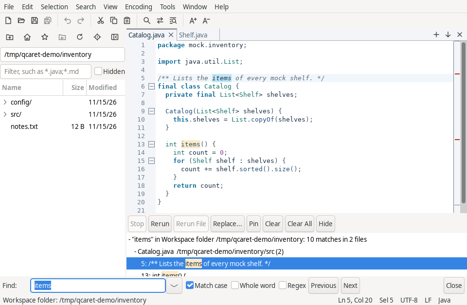

- The toolbar under the menu bar holds New, Open, Save, Save All, Print, Undo,
  Redo, Cut, Copy, Paste, Find, Replace, HyperSearch, Zoom In and Zoom Out, and
  for a Markdown tab the [Markdown preview](#markdown-preview) mode buttons and
  Markdown actions menu. Each button runs its menu command, and its tool tip
  names the keys. Undo and Redo are
  available when the document has a step to take, Cut and Copy with a selection;
  the keys work the same in the find bar and in dialogs. View > Toolbar hides it
  in every window, and the choice is saved. In a window too narrow for every
  button, a More button at the row's end lists the ones that do not fit
  whole, with their state; choosing one runs it. The toolbar keeps one height
  whatever tab is selected. A screen reader reads each
  button by its command, or on Linux with `--gtk4` by its tool tip.
- Common menu items show an icon on Linux and Windows, the same one as their
  toolbar button. macOS menus show none.
- The title bar shows the selected document's name, a `*` while it has unsaved
  changes, and its path.
- The tab row holds one tab per document. A dirty document's tab is marked, and
  so is a file missing on disk. A middle click or the close button closes a tab;
  dragging moves it. `Ctrl+W` closes the selected tab and `Ctrl+Shift+W`
  closes all; `Ctrl+PageDown` and `Ctrl+PageUp` select the next and previous
  tab. A tab's menu offers Close, Close Others, Close to the Left,
  Close to the Right, Close All, Copy Full Path, Copy File Name, Open
  Containing Folder and Move to New Window, for that tab. File > Close Multiple
  Tabs runs Close Others, Close to the Left and Close to the Right on the
  selected tab.
- Closing the selected tab selects the tab after it, or the one before when it
  was last. Preferences, Files, "After closing the shown tab, show the last used
  tab" selects the tab used most recently instead. Close All, Close Others and
  Close to the Left or Right close the selected tab last, so no other tab shows
  on the way; tabs with unsaved changes ask in tab order.
- Three buttons end the tab row. `+` opens a new document and `x` closes the
  selected one, asking first about unsaved changes. The arrow between them
  lists every tab, with the number of tabs that do not fit in the row beside
  it; separators set the tabs shown in the row apart from the others, and the
  selected one is checked. Choosing a tab selects it and brings it into the
  row. The mouse wheel or a trackpad scroll over the row selects the previous
  or next tab, one tab per notch, stopping at the first and last.
- A screen reader reads each editor by its tab title, the three buttons by
  their tool tips, the overview strip as Overview and the memory indicator as
  Memory with its figures. A search field reads by its label, and its history
  arrow as Show history.
- Closing a window's last tab opens an empty Untitled document in its place. An
  empty Untitled document with no unsaved changes stays open when it is the
  only tab. Preferences, Files, "Close the window with its last tab" closes the
  window instead; with the last window, QCaret quits as File > Exit (`Ctrl+Q`;
  Quit in the application menu on macOS) does. A tab dragged or moved to
  another window leaves its window empty.
- The editor shows line numbers, bookmark and fold marks in its gutter. View >
  Word Wrap, Show Whitespace, Show Line Endings, Overview Strip and Line Numbers
  apply to the window's editors. Zoom is `Ctrl+=`, `Ctrl+-` and `Ctrl`+wheel
  (`Cmd` on macOS); `Ctrl+0` returns to the Preferences size, and a new size
  or font in Preferences ends the zoom. When a Markdown preview, not the
  editor, had the focus last, the zoom keys, buttons and menu items act on the
  preview instead ([Markdown preview](#markdown-preview)).
- Those five and View > Workspace Browser change only their window, and the
  choice is saved as the start for new windows and for a start without the
  session; a window the session restores keeps its own. Preferences, View sets
  the same choices.
- A control character (U+0000 to U+001F except tab, U+007F and U+0080 to
  U+009F) shows as its two hex digits in a small box, such as `1B`, two columns
  wide, in the editor, a comparison, the replace preview's before and after
  view and File > Print. Caret moves, Backspace
  and Delete take it as one character; copy, save and search keep the
  character. A row holds at most 128 of them: a line with more continues on the
  next row, also with word wrap off. Search Results, the replace preview's
  matches, the Bookmarks list and the Outline show it as text, such as `<1B>`;
  Copy and Copy Line there copy the character. The Markdown preview, Basic and
  Browser, its printout and Export as HTML show it as text too, and the
  preview copies that text.

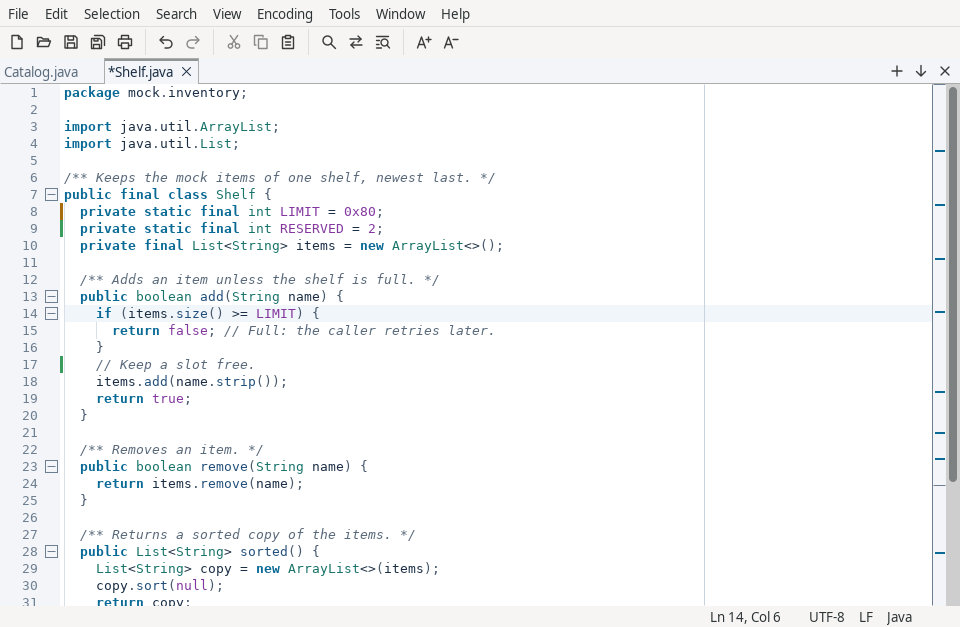

- View > Right Margin draws a line after column 80 in every editor, also with
  word wrap on; Preferences, Editor sets another column. The choice is saved.
- View > Indent Guides draws a faint line at each indent level of a line's
  leading spaces and tabs, at the document's tab width. A blank line carries the
  guides of the lines around it; a wrapped line's later rows have none.
- View > Modified Line Marks marks, right of the gutter, the lines added (green)
  or changed (amber) since the file was opened, saved or reloaded, and a red
  triangle where lines were removed. A document restored after a crash is
  marked against its file on disk. Saving clears the marks, and so does
  undoing back to the saved text. A document or saved text over 100,000 lines
  or 16 Mi chars shows no marks; the gutter's tooltip says so. Both choices are saved.
- Edit > Line > Wrap Paragraph rewraps the selected lines, or the paragraph at
  the caret, to the right margin column. Every line keeps the first line's
  indent, and a comment paragraph keeps its comment marker, such as `//` or
  `#`. A blank line ends a paragraph. Undo restores the text in one step.
- A right click in the text opens Undo, Redo, Cut, Copy, Paste, Select All,
  Toggle Bookmark, Edit Bookmark Comment, Toggle Fold, Open Path at Caret, the
  Format XML and JSON and Encode/Decode Text cascades, Toggle Line Comment and
  the Convert Case cascade for that view. A click in a selection keeps it; a
  click elsewhere moves the caret there first.
- The overview strip beside the scroll bar marks find matches, HyperSearch
  matches, bookmarks and an XML or JSON format error across the whole
  document; a click or drag scrolls there.
- View > Split shows a document in two views, side by side or one above the
  other, each with its own carets and scroll position. `F6` moves between them.
  View > Split > Unsplit returns to one view.
- View > Workspace Browser, Search > Search Results, Search > Bookmarks >
  Bookmarks List and View > Markdown View > Outline show the docks around the
  editor.
- The status bar shows notices, the read-only marker, line and column, the
  selection, encoding, line endings, language and, while a Markdown preview
  shows, its renderer. A click on the language
  chooses a grammar, one on the encoding reopens or saves with another
  encoding, and one on the line endings converts them to LF, CRLF or CR. A
  Warnings link appears when QCaret logs a warning and opens Help > Show Log.
- The pointer shows the busy cursor, an arrow with a spinner, while a command
  works in the background, and the window stays usable. It shows over the
  window for opening, saving, Save As, Save a Copy, reloading and comparing
  files, line-ending conversion, Recent Files > Clean Up, Open All, dropped
  files, Go Back and Go Forward to a closed file, the workspace browser's folder
  changes, New File, New Folder, Rename and Delete, HyperSearch's folder check,
  opening a search result, Open Path at Caret, copying a large set of search
  results or a long bookmarked line, the replace preview, Restore Replace Run's
  list, Generate from Selection into Clipboard, Reload Grammars, the Help
  menu's About, licenses, user guide, Debug Log File and folders, and the
  memory indicator's garbage collection. It shows over the editor for Sort, Remove
  Duplicate and Blank Lines, Reverse Lines, Trim Leading and Trailing
  Whitespace, Wrap Paragraph, Convert Indentation, Encode/Decode Text, Edit >
  Format XML and JSON, Add Next Occurrence, Go to and Select to Matching Bracket,
  Fold All and the selection commands on a long text. HyperSearch,
  Replace in Files, Generate from Files, Verify Checksums, statistics, printing,
  Quick Open and the workspace browser's folders show their own progress
  instead. After Open in Default Application, Open Containing Folder, Report
  Issue and the other commands that start another application, the busy cursor
  shows for one second. The busy cursor also shows over the editors and the
  dialogs of a busy window, and over a dialog opened while it works.
- View > Memory Indicator shows, at the right end of every window's status bar,
  the Java heap kept after garbage collection and the maximum heap, as
  `used/max MB` over a bar filled to that share. Its tool tip adds the heap in
  use now, the memory open documents hold of their 60% share, and the `-Xmx`
  option that raises the maximum (see [Large files](#large-files)). A
  click runs a garbage collection and the status bar names the memory it freed.
  The figures refresh every 2 seconds while the indicator shows. The choice is
  saved; it is off at first.
- View > Theme chooses Light, Dark or System, and the whole window changes at
  once. On Windows each window is rebuilt for the new theme while you keep
  working in it, and the new window then takes its place: tabs, unsaved text,
  carets, split views, the find bar, the docks and running searches stay,
  while windows it owns, such as Show Log, Statistics or a comparison, close,
  and a running Statistics count or Checksums run stops.
  A window with an open dialog, Preferences included, or an open menu changes
  once it closes. On Windows, menus and context menus keep the theme QCaret
  started with until the next start. Under dark, dialogs are dark, fields included;
  on Windows at a display scale such as 150% the selected item of an open
  drop-down list, such as Preferences' Theme, is not visible, while the other
  items read. On macOS menus from
  the menu bar keep the system appearance. Under System the theme follows a
  change of the system setting while QCaret runs, on Windows and macOS. On Linux
  a GTK theme with no dark variant keeps native controls light; the editor and
  tabs still change.
- Editor colors, on the Editor tab of Tools > Preferences, colors the editors,
  the tab strip, comparison windows and the replace preview, as a terminal
  profile colors only its text area; see [Editor colors](#editor-colors). Menus,
  docks, dialogs and title bars keep following View > Theme.
- View > Command Palette (`Ctrl+Shift+P`) finds and runs any menu command by
  name, Window > Minimize and Zoom included on every platform.

## Editing

Undo (`Ctrl+Z`) and Redo (`Ctrl+Shift+Z`, and `Ctrl+Y` off macOS) restore every
caret. Typing an opening bracket or quote inserts its closer; the grammar names
the pairs, and Preferences turns this off. Enter and a typed closer indent from
the grammar's rules.

| Keys | Action |
|---|---|
| `Shift+Delete`, `Ctrl+Insert`, `Shift+Insert` (not on macOS) | Cut, copy, paste, beside `Ctrl+X`, `Ctrl+C`, `Ctrl+V` |
| `Ctrl+D` | Duplicate the selection, or the line |
| `Ctrl+Shift+L` | Delete the line |
| `Alt+Up`, `Alt+Down` | Move the lines up or down |
| `Ctrl+J` | Join lines |
| `Ctrl+Shift+U`, `Ctrl+U` | Upper case, lower case (Edit > Convert Case only on Linux) |
| `Ctrl+Backspace`, `Ctrl+Delete` (`Option` on macOS) | Delete the word before or after each caret |
| `Ctrl+T` (`Control+T` on macOS) | Transpose: swap the characters around each caret, or rotate the texts of two or more selections |
| `Ctrl+]`, `Ctrl+[`, `Shift+Tab` | Indent, outdent |
| `Tab` on a selection that holds a line break | Indent the lines it touches; a selection within one line is replaced by a tab |
| `Ctrl+Tab`, `Ctrl+Shift+Tab` | Move the keyboard focus out of the editor, forward or back |
| `Ctrl+/`, `Ctrl+Shift+/` (`Cmd+Option+/` on macOS) | Toggle a line or block comment |
| `Ctrl+Space` (`Option+Esc` on macOS) | Complete the word from the open documents |
| `Ctrl+B`, `Ctrl+Shift+B` | Go or select to the matching bracket |
| `Ctrl+G` (`Cmd+L` on macOS) | Go to a line, as `line`, `line:column` or `line,column`; OK stays disabled until the text is one |
| `Alt+Left`, `Alt+Right` (`Ctrl+Cmd+Left` and `Right` on macOS) | Go Back and Go Forward through jumps, across documents |

Edit > Sort Lines (Ascending, Descending, Ignoring Case or Numerically), and
Remove Duplicate Lines, Remove Blank Lines, Reverse Lines, Trim Leading and
Trailing Whitespace and Convert Indentation to Spaces and to Tabs in Edit >
Line, act on the selected lines, or every line. Each is
one undo step, and `Esc` stops one still computing, as it stops a running
comparison. A line holding only spaces and tabs is blank. Sort Lines >
Numerically orders lines by the number at their start (after spaces and tabs:
an optional sign, digits and a decimal fraction, so `-2.5` before `10`); lines
without one follow in their order, and lines with equal numbers keep theirs.
Convert Indentation rewrites only the spaces and tabs at the start of each line
at the document's tab width; converting to tabs keeps as spaces the columns
short of a tab stop. In a file mixing CR and LF line endings, these commands,
Delete Line, Move Lines, Transpose and the trim at Save leave alone any line
whose change would merge a CR and an LF into one CR LF line ending, and the
status bar names how many lines they left. Edit > Tab Width (any width from 1
to 16 through Other), Indent with Spaces and Read-Only apply to the selected
document. Preferences, Editor sets the width and the indentation a document
without saved settings starts with. The bracket beside the caret and the other
occurrences of the word at the caret are highlighted.

Edit > Encode/Decode Text converts each selection in place and leaves it
selected; every selection converts or none does, as one undo step, and `Esc`
stops one still computing. With nothing selected, or when a selection is not
valid input, the status bar says so and the text stays as it is; a refusal
names the selection by its number, counting from the top.

| Command | Converts |
|---|---|
| Base64 Encode, Base64 Decode | The text's UTF-8 bytes to Base64 on one line, and back. Decode skips spaces, tabs and line breaks and accepts missing `=` padding; input outside the Base64 alphabet (including the URL-safe `-` and `_`) or bytes that are not UTF-8 text are refused |
| URL Encode, URL Decode | Percent-encoding of the UTF-8 bytes (RFC 3986): everything but letters, digits and `- . _ ~` becomes `%XX`, a space `%20`. Decode leaves `+` as it is and refuses a `%` without two hex digits or bytes that are not UTF-8 text |
| Escape XML Entities, Unescape XML Entities | `&`, `<`, `>`, `"` and `'` to `&amp;`, `&lt;`, `&gt;`, `&quot;` and `&apos;`. Unescape reads those, the HTML 4.01 named entities such as `&nbsp;` and `&euro;`, and `&#65;` and `&#x41;` references; anything else, such as `&bogus;` or an `&` without `;`, stays as it is |
| Escape JSON String, Unescape JSON String | The selection as the content of a JSON string, without the quotes: `"`, backslash and control characters get backslash escapes. Unescape refuses an unknown escape and an escaped surrogate without its pair |

Completion opens on its key, or by itself after the number of word chars set in
Preferences. Up, Down, Enter, Tab and `Esc` work in the list; typing narrows it.

Edit > Convert Case > Title Case capitalizes each word of the selections, or
the word at each caret; Swap Case swaps upper and lower case.

Edit > Insert Date and Time lists formats with the current time in each:
the one set in Preferences, Editor (a Java `DateTimeFormatter` pattern such as
`yyyy-MM-dd HH:mm`) first, the format used last selected. The chosen one
replaces every selection, as one undo step. Month and day names follow the
system's language.

Edit > Insert Number Sequence asks for a start, a step, a width and a base
(decimal, or hex in upper or lower case), then writes one number at each caret,
in text order, or on each row of a block selection from the top, replacing
selected text, as one undo step. Start and step may be negative and take `0x`
before hex digits; the dialog refuses a number outside 64 bits, and nothing is
inserted when a later number would leave that range. Width pads with zeros
after any minus sign, so `-1` at width 3 is `-01`. Hex is written with a minus
sign, never as two's complement. The dialog starts from the values used last.

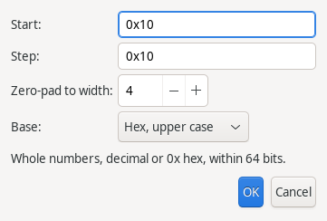

Tools > Document Statistics shows the selected document's lines, words,
characters, characters without spaces and bytes in its encoding, and the same
for the selections. A word is a run of characters that are not spaces, tabs or
line breaks; a character is a Unicode code point, so an emoji counts once. A
large document shows the percent counted; Refresh counts again after an edit.
In an encoding that can only be read, such as `x-JISAutoDetect`, bytes show as
unknown.

### Formatting XML and JSON

Edit > Format XML and JSON pretty-prints, minifies or checks XML and JSON:
each selection on its own, or the whole document when nothing is selected. Pretty
Print puts each element, member or array item on its own line, indented with
the document's tab width and Indent with Spaces; Minify removes that
whitespace. Only whitespace between tags and tokens changes: attribute spacing,
text, comments, CDATA, escapes and number spelling stay as they are. XML text
mixed with tags, text-only elements and `xml:space="preserve"` stay as written.
Each command is one undo step, and `Esc` stops one still computing.

A document that is not well-formed is not changed: the status bar names the
line, column and reason, the caret moves to the error, and a wavy underline
at the error and a mark in the overview strip, both in the color of invalid
text, show it until the next edit or the next format command that succeeds. Check
Well-Formed reports the same, or that the text is well-formed.

When Pretty Print or Minify has nothing to change, the status bar says why. It
names the first element whose content stays as written, with its line: one
holding text or CDATA beside child elements, or under `xml:space="preserve"`.
When that text is only a character that looks like a space or nothing, such
as a no-break space, the notice names the character. Otherwise it says the
text is already formatted or minified.

A selection may hold several XML elements, with comments or text between them,
without one enclosing element: it is formatted as a fragment, each element on
its own line at the indent of the selection's first line, and Check reports a
well-formed fragment. Text between the elements leaves the selection as
written. A fragment cannot hold an XML declaration or a DOCTYPE. With nothing
selected, the document must have one root element. QCaret never reads a DTD,
schema or entity from a file or the network; an internal DTD subset is read.

JSON may hold `//` and `/* */` comments: Pretty Print keeps each where it
stood, Check says the comments are not standard JSON, and Minify keeps `/* */`
comments and refuses a `//` comment. Preferences, Editor, Strict JSON refuses
every comment. Trailing commas, single quotes, unquoted names, `NaN` and
`Infinity` are errors either way.

Copy XML Path and Copy JSON Path, in the same cascade, copy the path of the
element, attribute, member or array item at the caret and show it in the status
bar:

| Format | Example | Rules |
|---|---|---|
| XML | `/catalog/book[2]/@id` | An index from 1 only where siblings share the name; prefixes as written; text, comments and CDATA give the element around them; outside the root element, `/` |
| JSON | `$.items[0].name`, `$['first name']` | Array indexes from 0; a name that is not letters, digits, `_` and `$` (not starting with a digit) is quoted |

Text that is not well-formed before the caret gives the same error as Check;
errors after the caret do not matter.

## Multiple carets and block selection

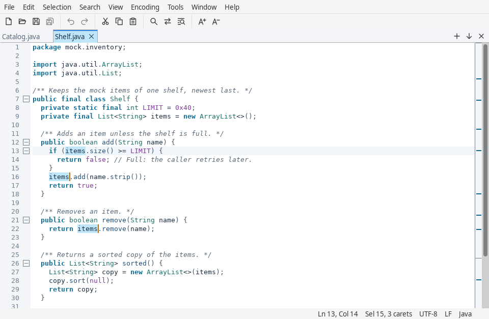

| Keys | Action |
|---|---|
| `Ctrl`+click (`Cmd` on macOS) | Add a caret, or remove the one clicked |
| `Ctrl`+drag (`Cmd` on macOS) | Add a selection |
| `Ctrl+Shift+Up`, `Ctrl+Shift+Down` (`Control+Shift` on macOS) | Add a caret above or below |
| `Ctrl+E` | Select the word, then add its next occurrence |
| `Ctrl+K` | Skip Occurrence: drop the occurrence added last and select the next one |
| `Alt+Enter` | Select every occurrence of the selection, or of the word at the caret |
| `Ctrl+Shift+Space` (`Ctrl+Cmd+Shift+Right` on macOS) | Expand Selection: word, quotes, brackets, line, then the whole text |
| `Ctrl+L` (`Control+L` on macOS) | Select the line; again to add the next line |
| Selection > Split into Lines | One selection per line of each selection |
| `Alt`+drag, `Ctrl+Alt`+drag | Select a block |
| `Alt+Shift`+arrow (`Cmd+Option+Shift` on macOS) | Extend a block by one row or column |
| `Alt+Shift`+click | Extend a block to the point clicked |
| `Esc` | Drop the extra carets or the block |

Typing, Backspace, Delete, caret moves and the Edit commands apply at every
caret. Copy joins the selections with the line ending. Paste with as many lines
as selections puts one line at each. A block can reach past the end of a short
line, and typing there pads the line.

Selection > Column Selection Mode makes a plain drag and `Shift` with an arrow
key select a block.

Selection > Undo Selection and Redo Selection step back and forward through the
caret and selection changes of the view, up to 100, without changing the text.
An edit starts the history again. Select All Occurrences selects nothing past
10,000 occurrences. Occurrences that touch, such as `ab` twice in `abab`, stay
separate selections.

## Search and HyperSearch

### Find bar

Search > Find (`Ctrl+F`) opens the find bar, with a selection on one line as
its text. Typing finds as you type and every match in view is highlighted. `F3`
and `Shift+F3` (also `Cmd+G` and `Cmd+Shift+G` on macOS), or Enter and
`Shift+Enter` in the bar, move between matches and wrap at the ends with a
notice. Match case, Whole word and Regex are toggles. `Esc` closes the bar.
Both fields keep a history: the arrow beside a field or `Down` opens its list,
`Up` and `Down` move through it without searching, and Enter or a click puts
the entry in the field and finds it. `Esc` closes only the list. An invalid
regular expression shows its error and the column where it fails.

### HyperSearch

Search > HyperSearch (`Ctrl+Shift+F`) finds every match in a scope and lists them
in the results dock while you work.

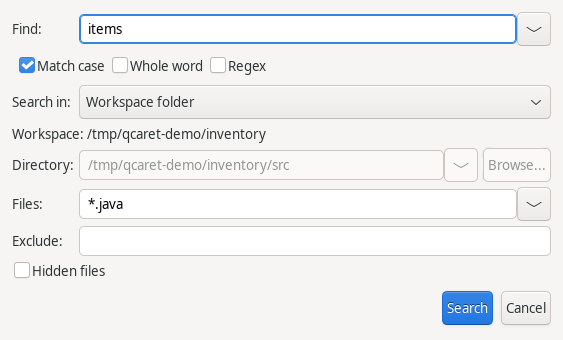

| Search in | Reads |
|---|---|
| Current document, Selection | The selected document, or the view's selections |
| Open documents | Every document open in the window |
| Workspace folder | The window's workspace folder and its subdirectories |
| Directory | The files of one directory |
| Directory and subdirectories | A directory's tree |

The text, directory and Files fields keep a history, opened and used as in the
find bar; Enter and `Esc` in an open list do not run the search or close the
dialog. Files and Exclude take masks separated by `;`, such as `*.java;*.xml`. Open
documents are searched as edited, in every scope, so a folder search reads an
unsaved buffer and not its file.

### Search results

The dock keeps ten sets, newest first; Pin keeps one past that. A set stops at
100,000 matches. Files over 64 MiB, binary and unreadable files and very long
lines are skipped, and the set's row counts them. Enter or a double click opens
a match; `F4` and `Shift+F4` step through the set, wrapping at the ends with a
notice. Stop ends a running search and keeps what it found; Rerun runs it again;
Clear and Clear All drop sets.

Right-click a row for Open, Copy, Copy All Results, Rerun, Pin, Remove Set,
Expand All and Collapse All. Copy puts one line per match on the clipboard, as
`path:line: text`: the row's match, a file's matches or a set's. The text keeps
the line's tabs and control characters. Copy All
Results copies every set. Expand All and Collapse All open and close every file
of the row's set.

A match in text changed since the search shows as stale. Opening one goes to its
line with a notice. Rerun File searches that file again.

## Replace

In the find bar, Search > Replace (`Ctrl+H`, `Cmd+Option+F` on macOS) adds the
replace row. Replace and Replace All are one undo step each. A regex
replacement can name groups with `$1` or `${name}`. Replace All keeps running
when you switch tabs and replaces in the document it started in; closing that
document cancels it, and an edit to it before the replace finishes drops the
replace with a notice. Over 10,000 replacements apply as one change, as Sort
Lines does: collapsed folds between the first and last match expand, and
bookmarks there move to the last match's line.

Across files, use the dock's Replace or Search > Replace in Results
(`Ctrl+Shift+H`) on a finished set.

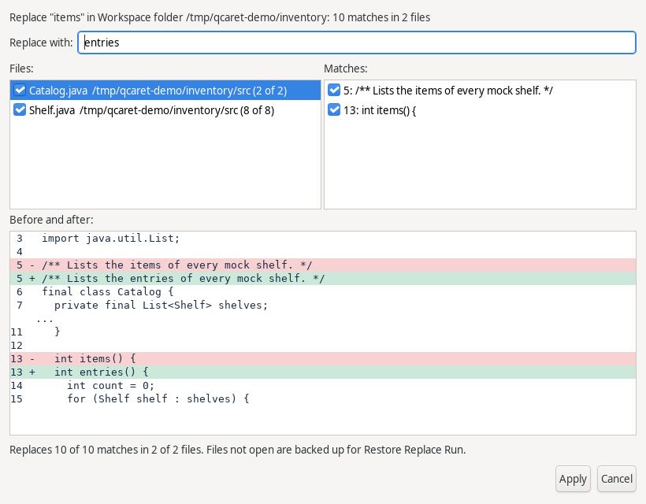

The preview lists every file and match with a check box and shows the selected
file before and after. Apply runs the replacement and opens a report of each
file: replaced, skipped with the reason, failed, or not attempted.

- An open document takes the replacement as one undo step and stays unsaved.
- A file not open is rewritten, with its original bytes kept under
  `replace-backups/` in the settings directory for 7 days.
- A file changed since the search is skipped.

No undo spans files. Restore Run in the report, or Search > Restore Replace Run,
writes a run's backups back, and refuses a file changed since the run. A file
whose write failed partway keeps its backup, and Restore Run puts the original
back.

## Bookmarks

| Keys | Action |
|---|---|
| `Ctrl+F2` | Toggle a bookmark on each caret's line |
| `F2`, `Shift+F2` | Next and previous bookmark, wrapping |
| `Ctrl+Shift+F2` | Edit the line's comment, bookmarking the line |

A bookmark shows as a bar in the gutter and a commented one as a flag, with the
comment as its tooltip. Bookmarks follow their lines through edits. Search >
Bookmarks > Bookmarks List shows the document's bookmarks with Go To, Edit
Comment and Remove. Right-click a row for those, Copy Line, which copies the
whole line, and Clear All. Search > Bookmarks > Clear Bookmarks removes every
bookmark of the document. A document holds up to 1,000 comments of 1,000
chars.

## Folding

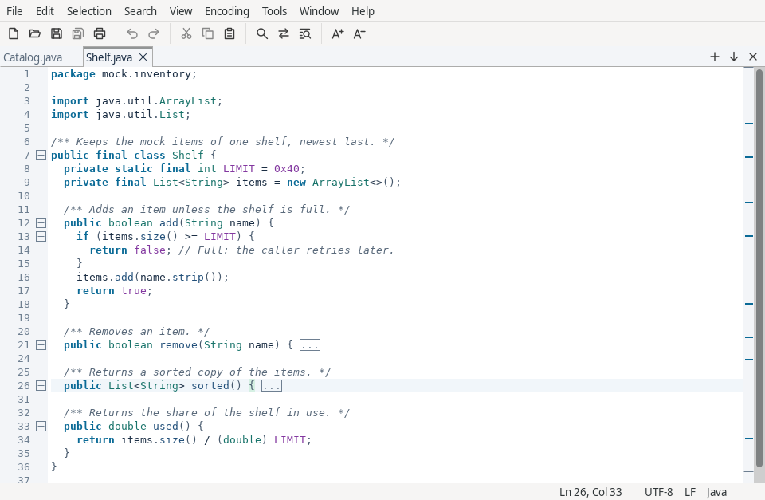

A box in the gutter marks each line that starts a fold region; a click toggles
it. A collapsed region's first line ends in a box with an ellipsis. Regions come
from the grammar's brackets, block keywords or section headers, such as
Markdown headings, TOML tables, INI sections, Dockerfile stages and diff files
and hunks, and from indentation otherwise. Multi-line comments and strings fold
in every language, as do Markdown code fences and region markers: `#region` in
C# and VB.NET, `#pragma region` in C and C++, `// #region` in JavaScript,
TypeScript, Java and Kotlin, each closed by its `endregion` line.

| Keys | Action |
|---|---|
| `Ctrl+Shift+[`, `Ctrl+Shift+]` | Fold, unfold |
| `Alt+[`, `Alt+]` (`Cmd+Option+[`, `Cmd+Option+]` on macOS) | Fold all, unfold all |
| View > Folding > Toggle Fold | Either, at the caret |

An edit inside a collapsed region expands it. A command that puts the caret in
hidden lines, such as find or Go to Line, expands the regions hiding it. Each
split view folds on its own.

## Syntax highlighting

QCaret highlights 35 languages and 12 file formats:

| Kind | Grammars |
|---|---|
| Languages | Plain Text, Java, XML, HTML (with embedded JavaScript and CSS), JSON, YAML, SQL, Python, JavaScript, TypeScript, C, C++, Shell Script, PowerShell, Windows Batch, Properties, INI, CSS, Markdown, Go, Rust, C#, Kotlin, Ruby, PHP, Perl, Lua, Groovy, Scala, Swift, Dart, R, Haskell, Objective-C, VB.NET |
| File formats | Dockerfile, Makefile, CMake, TOML, diff and patch, CSV and TSV (one color per column), log files (levels, timestamps, stack traces), HCL and Terraform, Protocol Buffers, GraphQL, nginx configuration |

The grammar follows the file name, its extension or its first line (a shebang,
`<?xml`, `<!DOCTYPE html>`). View > Syntax, or a click on the status bar's
language, chooses another one for the document, from the last five chosen or a
category submenu. A line over 10,000 chars shows without colors; Preferences
changes that limit. Edit > Toggle Line Comment and Toggle Block Comment use the
grammar's comment delimiters.

User grammars are XML files in `grammars/` in the settings directory, read at
startup. One with a built-in grammar's id replaces it, and its `category`
attribute picks its Syntax submenu (User without one). View > Syntax > Reload
Grammars reads them again, and an invalid file is skipped with a notice. The
format is in `qcaret-core/docs/grammars.md` in the QCaret source repository.

## Markdown preview

A tab whose language is Markdown, detected from a `.md` or `.markdown` name or
chosen in View > Syntax, shows its document in one of three modes:

| Mode | Shows |
|---|---|
| Source | The editor alone |
| Split | The editor with the preview on its right, scrolling together while Sync Scrolling is on; with a split editor, right of both views |
| Preview | The preview alone |

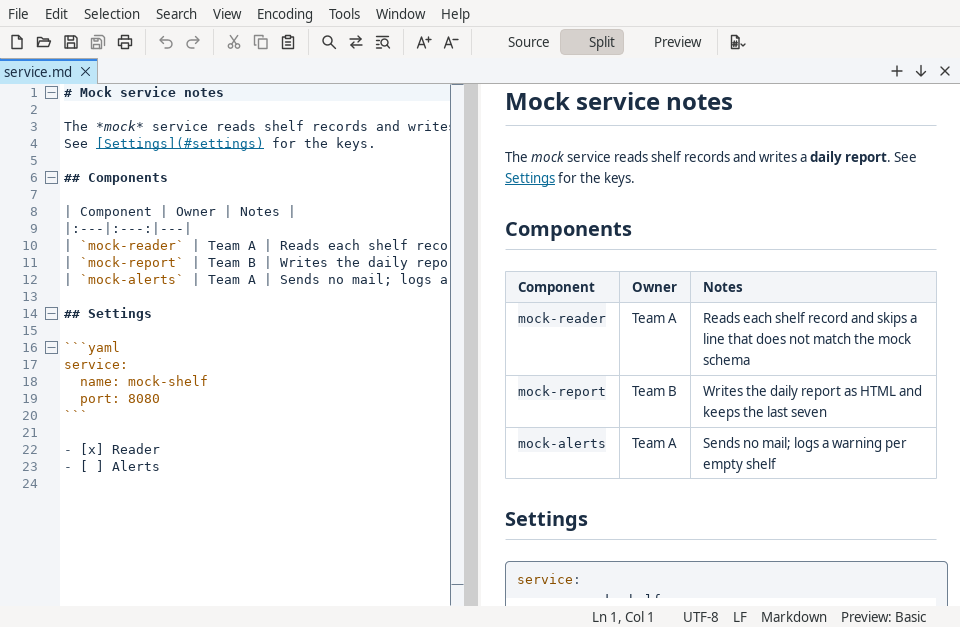

The `Source | Split | Preview` buttons at the end of the toolbar and View >
Markdown View switch the selected tab. After them, the Markdown actions button
opens a menu of Basic and Browser, Sync Scrolling, Outline, Export as HTML and
Print Rendered Markdown, each doing what its menu item does and showing the
same state. `Ctrl+Shift+M` (`Cmd+Shift+M` on macOS)
steps the tab from Source to Split to Preview and back to Source, from the editor or
the preview; View > Markdown View > Cycle Markdown View does the same. A file opens in the
mode chosen in Tools > Preferences, Appearance, Markdown files open in (Split
by default). Once you pick a mode for a file, it opens in that mode from then
on, whatever the setting; a session restores each tab's mode. Find, Replace and
HyperSearch act on the source; in Split the preview follows the editor to a
match. In Preview, each match Find, Replace or a HyperSearch result selects
scrolls the preview to the match's paragraph, heading or other block, and the
Basic renderer also selects the match's rendered text when that text appears
once in the block; a match in markup that does not render, such as a link
address, only scrolls. The find bar keeps the focus, and closing it returns to
the preview. Preview text can
be selected and copied.

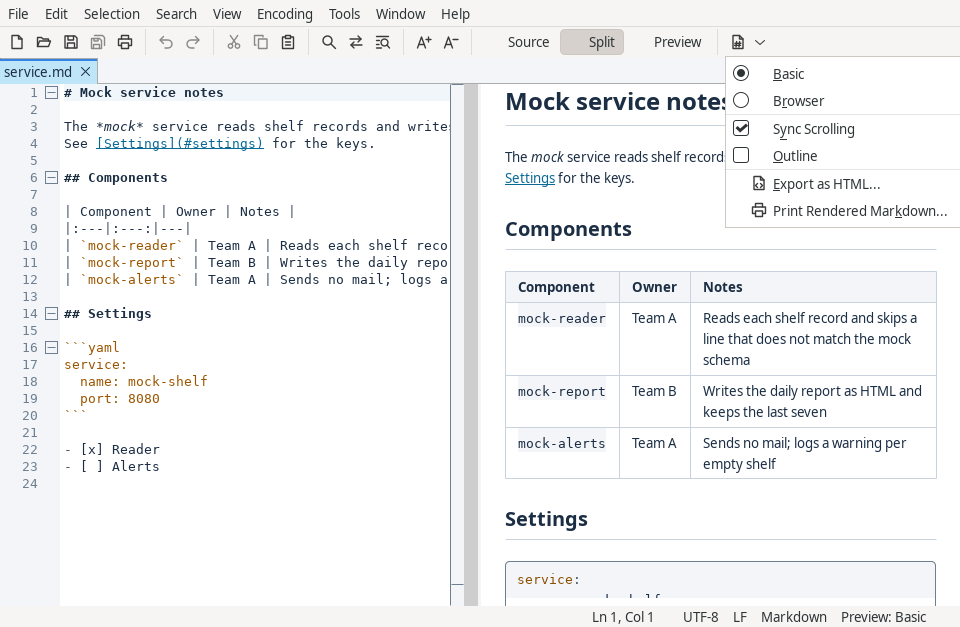

The preview renders again 0.3 seconds after you stop typing. A document over
1 MiB of chars renders only when you click Render above the preview. A click on
a link scrolls to a heading or footnote, opens a local file in QCaret (a path
relative to the document or a `file:` address, in either renderer; with a
`#heading`, at that heading), or opens an `http`, `https`, `mailto` or `ftp`
address in the system browser after asking: the dialog shows the full address,
and Cancel, the default for Enter and Esc, opens nothing. A link with another
scheme does nothing, and nothing loads without a click.

### Opening at a heading

`guide.md#setup` opens `guide.md` with the caret at the start of the heading
`setup` names and that line at the top of the editor; in Split or Preview the
preview scrolls to it. Preview links, the command line, Open Path at Caret and
Quick Open take this form, and a file already open has its tab selected and its
caret moved. The heading is named as a link inside the document names it, by
GitLab's rules: lower case, a space as `-`, other punctuation dropped, and `-1`,
`-2` added to repeated headings. An escape such as `%20` is decoded once. An id
no heading has opens the file at its first line, or leaves a file already open
where it was, and a file that is not Markdown ignores the `#heading`; each shows
`No heading #<id> in <file>` in the status bar. A file whose name holds the `#`, such as `notes.md#1`, opens as named.

The preview has its own zoom, kept apart from the editor's: `Ctrl+=`, `Ctrl+-`
and `Ctrl+0` (`Cmd` on macOS), the toolbar's Zoom buttons and View > Zoom In,
Zoom Out and Reset Zoom act on the preview when it, not the editor, had the
focus last, and `Ctrl`+wheel over the preview zooms it
whatever has the focus. Each step is 10 percent, from 50 to 300 percent; every
window's previews follow, and `qcaret.conf` keeps the size as
`markdown.previewZoom`. Images keep their size, and Print Rendered Markdown and
Export as HTML do not zoom.

The Basic renderer draws headings, emphasis, lists and task lists, quotes,
alerts, footnotes, tables, code blocks in a bordered box with QCaret's grammar
colors, and local PNG, JPEG, GIF, BMP and TIFF images in the current theme. A table narrows its
columns to the preview's width, and a long cell wraps inside its column. In a
narrow preview the cell padding narrows before a cell wraps or a word breaks,
a word breaks only when it is wider than its column's share of the preview,
and the table stays inside the preview. A preview too narrow for one character
per column shows "Table too wide for this pane" in place of the table until it
is widened, for example by switching to Preview mode. A wrapped code line continues under
its own indent. The cell and code box padding follow the preview's zoom. An SVG
or an image that does not decode shows as a box with its name; a remote image
shows its alt text and address. View > Markdown View, or the Appearance tab of Preferences,
chooses the renderer for every window; the status bar names it, a click on
that name offers Basic and Browser, and `qcaret.conf` keeps the choice as
`markdown.previewRenderer` (`basic` or `browser`).

View > Markdown View > Sync Scrolling, on by default, makes the editor and the
preview in Split scroll together in every window; the Appearance tab of
Preferences has the same check box, and `qcaret.conf` keeps it as
`markdown.syncScroll` (`true` or `false`). With it off, neither side moves the
other; the Outline dock, a find match and a link to a heading still scroll the
preview.

In the Basic preview, Ctrl+A (Cmd+A on macOS) selects all its text and Ctrl+C
(Cmd+C) copies the selection; its context menu has Copy and Select All. In
Split, Ctrl+A selects only the side that has the focus.

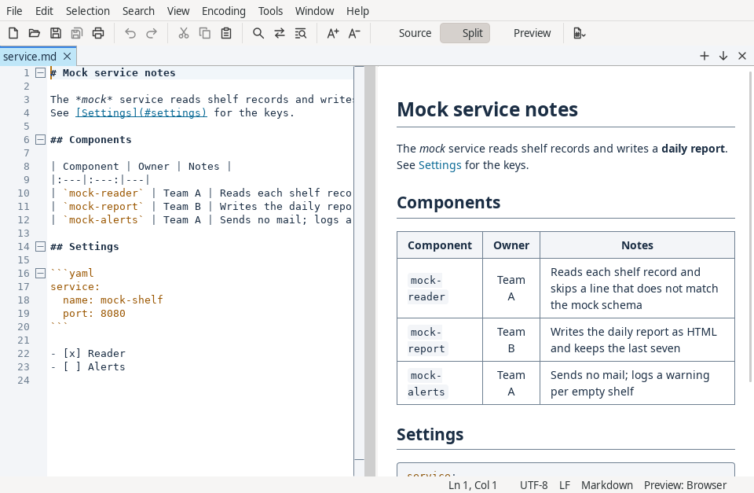

The Browser renderer shows the preview as a web page in the system's browser
control, with a stylesheet resembling GitLab's in the current theme, and shows
HTML in the document as written. JavaScript is off and nothing outside the
page loads: local images are embedded in the page, and a remote image shows as
a link. In Split the preview follows the editor; scrolling the preview does not
move the editor. On Windows and macOS the preview does not scroll to follow the
editor, the Outline dock or a find match. View > Markdown View >
Browser is disabled under GTK 4, where WebKitGTK does not start, and for the
rest of the run after the browser control fails to start or a page does not
load in time (60 seconds for the browser control to start, then 15 seconds);
its tool tip, or its
label under GTK 4, gives the reason. Browser in the Markdown actions menu and in
the status bar's renderer menu is disabled with the same reason. A saved Browser choice then shows Basic
with the notice "Browser preview unavailable; showing Basic".

File > Export as HTML writes the selected Markdown tab, unsaved edits
included, as one HTML file in the Light theme that opens without QCaret or a
network: local PNG, JPEG, GIF, BMP, WebP, SVG and TIFF images are embedded,
remote images are links, and links stay as written. An image over 16 MiB, or
one that would take the document's embedded images past 64 MiB, shows as its
alt text. Choosing the document's own file as the target writes nothing and
says so.

View > Markdown View > Outline, also in the Markdown actions menu, shows the Outline dock right of the editor: the
selected Markdown tab's headings as a tree, in any mode, updated 0.3 seconds
after you stop typing. Clicking a heading moves the caret to it and puts it at
the top of the editor and the preview; Enter or a double click also returns the
focus to the editor, or to the preview in Preview. The arrow keys and typing a heading's first letters move
the selection without moving the caret, and the selection follows the caret.
The dock lists nothing for a document over 1 MiB of chars. On a tab that is not
Markdown the dock folds away and returns at the next Markdown tab. A screen reader reads
the tree as Outline, except on Linux with `--gtk4`.

File > Print Rendered Markdown, enabled on a Markdown tab, prints the document
in the Basic renderer's fonts, colors and table layout, in any mode, with code
blocks on a plain shade and no extra space between blocks. It opens the same dialog as File >
Print (on Linux with GTK 4, the PDF file name) and prints the whole document; a
page range applies, a selection does not. Each page has the file name and Page
N of M at the top, and the colors are the light theme's on white. A table row,
a code line or an image never splits across pages, a heading does not end a
page, and a table continued on a new page repeats its header row. A table wider
than the page has its columns narrowed to fit, each cell wrapping inside its
column; a column keeps its longest word, so a table of long words can stay
wider than the page. It has no
default key; progress, Cancel and the one-job limit are as for File > Print.

## External changes

QCaret checks each open file every 5 seconds and when a window activates. On
Windows and Linux a change to the file's folder also starts a check at once; on
macOS a change shows at the next check.

| The file on disk | Without unsaved changes | With unsaved changes |
|---|---|---|
| Changed | Reloads | Asks: Keep Mine, Reload or Compare |
| Deleted | Stays open, unsaved, marked missing | Same |
| Back with the same bytes | The mark clears | The mark clears |

QCaret waits until the file stops changing, for up to half a second, so one
write by another program asks once. A reload is one undo step and keeps each
view's caret line and column. It reads the file as an open does, so a file
another program converted shows its new encoding; a charset chosen with Reopen
with Encoding stays. Text typed during a reload stays, and QCaret asks. When the
change does not fit in memory or the file cannot be read as text, the tab keeps
its text and a notice shows once per change. Keep Mine makes the next save ask.
A save that finds the file changed asks: Overwrite, Reload, Compare or Cancel.
Preferences, Files sets the interval and can make a clean document ask too.

## Workspace

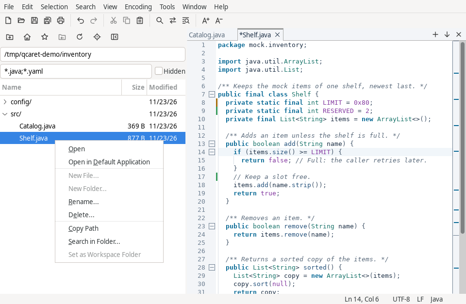

File > Set Workspace Folder gives each window one folder, the scope of
HyperSearch's Workspace folder and of Quick Open's file list. View > Workspace
Browser shows its tree. Enter or a double click opens a file, and so does
dragging it onto the editor, the tabs or anywhere on a QCaret window; a drag to
another program copies the file. Hover over a row for its full path, size and
modified date and time. The icons above the tree show their names when you
hover over them. Tab reaches each icon and Space runs it. Refresh lists the folder
again, Reveal Active File selects the current document's file, and Hide Browser
hides the browser. A row's menu offers Open, Open in Default Application, New
File, New Folder, Rename, Delete, Copy Path, Search in Folder and Set as
Workspace Folder; right-click empty space in the browser to act on the shown
folder itself. Open in Default Application refuses a file the system would run
and shows a notice: on Windows a program, script, shortcut, installer or other
type Windows runs (`.exe`, `.bat`, `.ps1`, `.jar`, `.lnk`, `.url` and others)
or an extension listed in `PATHEXT`; on macOS a `.command`, `.terminal`,
`.tool`, `.jar`, `.webloc`, `.inetloc` or `.fileloc` file, or a file with the
execute permission; on Linux a file with the execute permission. Open such a
file in QCaret instead.

Ctrl-click (Cmd-click on macOS) adds or removes a row, and Shift-click selects
a range. With several rows selected, Open, Open in Default Application and
dragging take every selected file (on GTK 4 a drag takes only the row pressed),
and Open in Default Application asks first for more than 10 files; Copy Path
copies every path, one per line; Delete deletes every selected file and folder
after one prompt. New File, New Folder, Set as Workspace Folder and Enter act
on the row you clicked last. Search in Folder and Rename take one row.

The browser can show any folder without changing the workspace folder, which
stays the scope of Quick Open and HyperSearch. The path field shows the shown
folder; hover over it to see whether that is the workspace folder. Type a path
there and press Enter: a path relative to the shown folder, or `~` for your home
folder. Parent Folder and Home Folder move up and home; Workspace Folder shows
the workspace folder again. Favorites lists your favorite folders and adds or
removes the shown one. The filter field takes patterns such as `*.java;*.md`
and applies to files, not folders; it ignores case on Windows and macOS. Hidden
lists hidden entries. The Modified column shows the date; the row's tool tip
adds the time. Sizes, dates and times follow the system's language. Click a
column header to sort by name, size or modified time, and again to reverse. Each window keeps its shown folder, filter and Hidden
setting in the session. A change made in one window's browser shows in every
window's.

| Command | Effect |
|---|---|
| Search in Folder | Opens HyperSearch on the folder and its subdirectories, or on a file's folder; press Search to run it |
| New File, New Folder | Asks a name and creates the entry in the folder; a new file opens in a tab |
| Rename (F2) | Asks a new name in the same folder; open documents under it follow with their unsaved changes |
| Delete (Delete key; on macOS delete or fn-Delete) | Asks first, naming what goes and how many files and folders a folder holds, then deletes permanently: there is no trash and no undo |

A name must be a single file or folder name, and a name already in use is
refused. On Windows a name ending in a dot or space is refused, since Windows
would drop it. A link is renamed or deleted as the link; its target stays. Rename
and Delete refuse with a notice while a file in the entry is being saved, copied,
reloaded or renamed or has a change question open, or while a save, a copy or a
checksum list is being written into it. Open
documents under a deleted entry stay open, marked missing, and Save writes them
again. A folder delete that fails partway stops and says what is left. Renaming
the workspace folder or a folder above it moves the workspace folder in every
window; deleting it leaves no workspace folder set. A notice says so.

Hidden entries and the excluded directories (`.git`, `.svn`, `.hg`, `target`,
`node_modules` and `build` by default) stay out of the browser, Quick Open and
folder searches; the browser lists hidden entries with Hidden checked.
Preferences, Search and Workspace changes the list.

Preferences, Search and Workspace, Default workspace folder sets the workspace
folder of a new window and of the window of a start that restores no session:
Choose picks it, Clear removes it. A restored window keeps its own. A default
folder that no longer exists leaves the workspace folder unset.

A folder lists its first 50,000 entries. A folder the browser cannot list
shows one row saying why, such as
`Access denied: My Documents`. On Windows, `My Documents`, `Application Data`
and the other compatibility links in your profile deny listing; Windows marks
them hidden and system, so they show only with Hidden checked.

## Quick Open

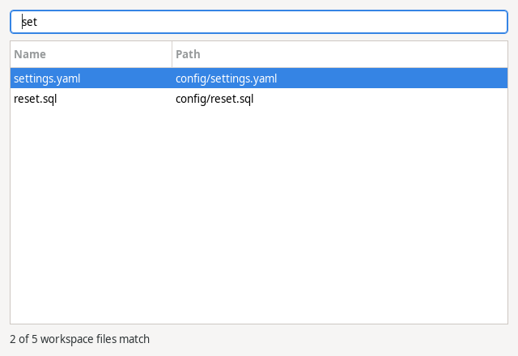

File > Quick Open (`Ctrl+P`) matches a typed name against the open documents, in
bold, then the workspace files, up to 200,000 indexed, then Recent Files. The
query's letters match in order and need not be adjacent. A query ending in
`:line` or `:line:column` opens there, and `guide#setup` opens `guide.md` at
that heading (see [Opening at a heading](#opening-at-a-heading)). With nothing typed it lists the open
documents and Recent Files. Window > Switch Document (`Ctrl+Shift+O`) is the same
list over the open documents.

Search > Go to Symbol (`Ctrl+R`, `Cmd+R` on macOS) lists the functions, classes,
headings and other definitions of the document, found by its language; typing
narrows the list, and Enter moves the caret to the one selected. In Quick Open,
`@` followed by a name does the same, and `Shop@total` opens `Shop.java` at
`total`. Definitions inside comments and strings are left out. The list of a
document unchanged since it was last shown opens at once; after an edit, the
document is read again from the edited lines.

## Compare

View > Compare > Compare Documents compares the selected document with another
open one; Compare with File on Disk compares it with its file, and so does the
Compare button of a change prompt. `--diff <a> <b>` compares two files from the
command line.

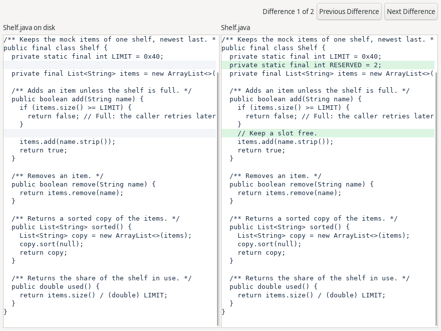

The comparison is a read-only window with the two sides scrolling together. `F7`
and `Shift+F7` step through the differences, and `Esc` closes it. A side over
100,000 lines or 16 Mi chars gets a notice instead. Past 1,000 inserted and
removed lines, the rest of a comparison shows as removed, then added. A line
over 10,000 chars shows cut, with a notice.

## Checksums

The Tools menu has a submenu for each of MD5, SHA-1, SHA-256 and SHA-512. MD5
and SHA-1 detect accidental changes only; use SHA-256 or SHA-512 where someone
could alter a file on purpose. An algorithm your Java runtime does not offer
shows disabled, with the reason in its tool tip.

- Generate shows the hash of the text you type, encoded in UTF-8, with Copy.
- Generate from Files hashes the files you choose into a list in the
  `sha256sum` format, `<hash>  <name>`, with a progress bar and Cancel. Files
  from several folders are named by their path below the common folder, such
  as `a/x.txt`. Copy and Save As take the list; saved in that common folder,
  the list verifies with Verify Checksums. Save As writes the list as Save
  writes a file and refuses, with a notice, a folder the workspace browser is
  renaming. A list saved over a file open in a tab reaches that tab as a change
  made by another program.
- Generate from Selection into Clipboard copies the hash of the selected
  text as the document saves it: in the document's encoding, without a byte
  order mark, line breaks as the document holds them. Several selections join
  with the document's line ending, as Copy joins them. The notice shows the
  encoding, the line ending and the hash.

Tools > Verify Checksums checks a `sha256sum`-style list: the selected
document, when it has a file, or a list chosen with Choose List. A line may use
`*` before the name. Names are relative to the list's folder; an absolute name
on a local drive is checked where it points. Each file shows OK, FAILED,
MISSING or unreadable with the reason (a file behind a folder you cannot open is
unreadable, not MISSING), lines that are not checksum lines are listed,
and the totals end the list. Lines may end in LF, CR LF or CR, and a chosen
list may start with a UTF-8 byte order mark.

Verify opens only regular files: a folder, pipe or device is unreadable and is
not opened. On Windows, a device name (`CON`, `\\.\`, `\\?\`) is unreadable,
and so is a network name (`\\server\share\...`) unless the list is on that
share.

## Sessions and recovery

A start restores the last session: every window at its position, with its
tabs, carets, scroll, splits, folds, bookmarks, read-only state, view options,
workspace and dock contents. A file that does not open is named and skipped.
Search results return as requests, and Rerun fills them. A closed file keeps
its caret, tab settings, encoding and grammar for when it opens again. Files
named at the start (`qcaret file.txt`, a double-click in the file manager, Open
With, on macOS a drop on the Dock icon) open after the restore in the first
window, and the last one opened is selected; a file a restored tab already
shows has that tab selected. A start with `--diff`, `-m` or `--no-session`, or
while another instance owns the session, restores none.

With Preferences, Files, "Restore the session at start" off, a start opens one
window, with an untitled document when it names no file, and saves that window
as the session; Recent Files and file positions are kept, `--session` restores the
windows of the previous run, and buffers that Quit without asking kept are
offered in the recovery list.

The session holds at most 32 windows, 256 tabs over all windows and 20 Recent
Files; each window keeps at most 32 retained searches, 1,000 expanded folders
and 20 Recently Closed files. A save past a limit leaves the rest out, and the
first such save in a run names what in the status bar. Bookmark comments past
1,000 are left out and reported at the next start. The remembered state of
closed files keeps the last 500.

While a document has unsaved changes, QCaret writes it to `recovery/` in the
settings directory every 30 seconds. After a crash the next start lists those
buffers with the state of each original file:

- Restore opens the buffer with its unsaved changes and leaves the original file
  alone. When the original cannot be read, the next save asks first.
- Discard deletes the recovery file.
- Later keeps it for the next start.

A recovery file that cannot be read is listed as such and kept, and the other
buffers are listed as usual.

Recovery files left by a crash are kept for 30 days. With Preferences, Files,
Quit without asking on, Exit asks nothing and the next start restores unsaved
and untitled buffers, and closing one of several windows moves its unsaved tabs
to another window (see [Windows and the running
instance](#windows-and-the-running-instance)). Exit during a restore waits for the restore to end; Cancel
on the load row ends a slow one, and that tab leaves the next session.
This holds only for the instance that owns the session, one that restored it
at its start, with or without files. A start with `--diff`, `-m` or
`--no-session`, and a start while another instance owns the session, own none,
and their Exit asks about each unsaved document.

When QCaret closes on an internal error, it asks nothing and keeps every
unsaved buffer for the recovery list. The next start shows a status bar notice
pointing to Help > Show Log, once. The next start that would restore the
session opens one window without the session's windows and tabs; files named on
the command line still open, and the recovery list offers the unsaved buffers,
those Quit without asking kept included. Settings, Recent Files and file
positions are kept.

## Windows and the running instance

Window > New Window opens another window. Settings, the theme, key bindings,
grammars and Recent Files are shared; each window has its own tabs, find bar,
workspace folder and search results. A document is open in one tab of one window
at a time.

On macOS the Window menu starts with Minimize (`Cmd+M`) and Zoom, which
switches the window between its size and filling the screen. Elsewhere the
title bar has both and the Window menu leaves them out; the command palette and
Tools > Preferences, Keys still list them, and they act on the window in front.
While a tool window such as Preferences, Statistics or a comparison is in front,
the menu bar keeps the main menus, and their commands act on the window that
opened it; Close (`Cmd+W`), Minimize and Zoom act on the tool window, and
minimizing a tool window, from the menu or its title bar, leaves the
main window on screen.

View > Always on Top keeps a window above other applications' windows, with its
dialogs above it; the session restores it per window. It has no default key. On
Linux it needs GTK 3 on X11; under Wayland or GTK 4 the item is disabled, and
the window manager's window menu (`Alt+Space` on most desktops) offers the same.

View > Full Screen (`F11`; `Ctrl+Cmd+F` on macOS) fills the screen with the
window; the same command returns it. On Linux and Windows the menu bar stays;
on macOS the window moves to its own space, the menu bar shows at the top edge,
and the window's green button does the same. `Esc` does not leave full screen.
A restart opens the window at its size before full screen.

Dialogs and tool windows open centered over their window and inside the
screen, shrunk to fit when the screen is smaller. HyperSearch, Preferences,
Keyboard Shortcuts, the command palette, Quick Open, Show Log, text windows,
the replace preview and report, comparisons and the Guide reopen at the size
they last closed with.

Drag a tab out of every QCaret window to open it in a new window, or onto another
window's tab strip to dock it there; Window > Move to New Window and the tab
menu do the first. A dragged-out tab's window opens with its top-left corner at
the drop point, moved onto the screen where it does not fit there. The document
moves live and nothing is read again: undo
history, unsaved changes, carets, scroll, folds, bookmarks and its recovery file
go with it. A tab with a save, copy, reload, conversion, Reopen with Encoding or
workspace browser rename running, or with a change question open, does not move,
and a notice says so.
Search results stay in their window and still lead to the moved tab.

File > Exit (Quit in the application menu on macOS) asks about unsaved documents
in every window before anything closes; Cancel leaves everything as it was, and
a save that fails stops the quit. Closing a window asks about its own documents;
closing the last one quits. With Quit without asking on, closing a window that
is not the last asks nothing: its unsaved tabs, untitled ones included, move to
the window used last, as a tab move does, and its saved tabs close. A tab whose
save or other file operation is running stays and is asked about. While Exit runs, closing a window does nothing. A
document edited while its save from a close prompt runs stays open and asks
again.

A second launch on the same settings directory passes its files to the running
QCaret and exits. They open in the window activated last, or a new one with `-n`.
On macOS this holds for Finder's Open With too when it starts another copy of
QCaret, such as one installed at another path.
On Windows a file opened from Explorer into the running instance does not raise
its window; the window's taskbar button flashes instead.
Launches at the same moment queue, and each file becomes a tab in the one
instance. A launch hands its files over only when `instance.endpoint` in the
settings folder is a file the user owns that no other account can read or
write; otherwise, or when another account that can write the settings folder
deletes the file, the launch opens its own window and QCaret's log names the
reason. `-m` runs an independent instance that saves no window placement or
session. One instance at a time keeps the session: a launch that cannot hand
its files over while another instance keeps it opens a window without the
session and saves none. QCaret refuses to open or replace `instance.lock` in
the settings folder, the file that identifies the running instance,
`qcaret_session.lock`, held by the instance that keeps the session, and each
`owner.lock` it holds under `recovery`.

File associations: on Linux run `bin/install-desktop-entry`; on Windows run
`register-associations.cmd`; the macOS bundle declares its document types itself.

## Preferences

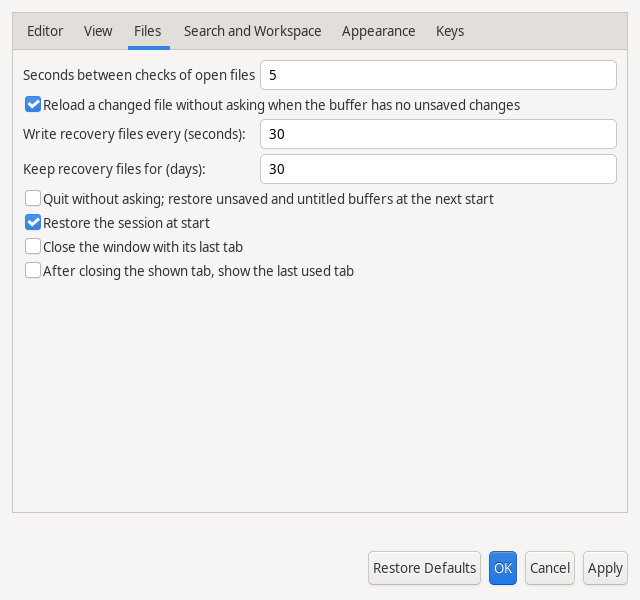

Tools > Preferences (`Ctrl+,`; the application menu on macOS) applies to the
running windows without a restart. `Ctrl+PageDown` and `Ctrl+PageUp` from a
field select the next and previous tab; on macOS focus moves into the new tab,
so the keys repeat.

| Tab | Holds |
|---|---|
| Editor | Completion trigger, auto-close, longest line with syntax colors, tab width and spaces for new documents, right margin column, date and time format, `.editorconfig` files and modelines on or off, strict JSON, line ending and encoding for new documents, editor colors |
| View | What a new window starts with: word wrap, whitespace and line-ending marks, overview strip, line numbers, workspace browser. What every window shows: toolbar, right margin, indent guides, modified line marks, memory indicator |
| Files | Seconds between file checks, reload without asking, recovery interval and keep time, quit without asking, restore the session at start, close the window with its last tab, show the last used tab after a close |
| Search and Workspace | Longest line searched, days a replace run's backups are kept, excluded directories, default workspace folder, Clear History |
| Appearance | Theme, editor font size, editor font, Markdown preview renderer, Sync Scrolling, the mode Markdown files open in |
| Keys | Every command's keys, with a filter: Clear, Add, Remove, Default Keys, Restore All Defaults |

Restore Defaults fills every tab with the default values; nothing changes until
OK or Apply. Add refuses a key that types text or that another command holds,
and names that command; a changed command reads "(changed)". Restore All
Defaults drops every key change on OK or Apply. Clear History removes the
saved search texts, replacements, directories
and masks, and the searches kept in the session. When another QCaret window owns
the session, its saved searches stay and a notice says so: close that window,
then press Clear History again.

### Editor font

Editor font lists the installed monospace families, filled in a moment after the
dialog opens; columns need letters of equal width, so proportional fonts are not
offered. Only TrueType and OpenType files in the system and user font folders
are listed, and only families the platform reports as installed. If the chosen
family is uninstalled, QCaret logs a warning and uses the platform's font until
it returns. The font applies to every editor, the
comparison windows, the replace preview and the log and license windows.

### Editor colors

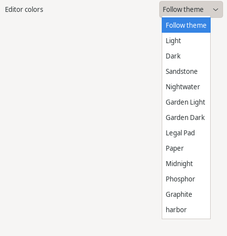

Editor colors lists Follow theme (the default), Light, Dark, the bundled schemes
and then your theme files. A choice applies at once.

| Choice | Colors |
|---|---|
| Follow theme | Light or Dark, as View > Theme resolves |
| Light, Dark | Navy text on white; light text on navy |
| Sandstone, Nightwater | Muted accents on warm cream; the same accents on deep teal |
| Garden Light, Garden Dark | Clear accents on light gray; bright accents on charcoal |
| Legal Pad | Black on light yellow |
| Paper | Black on white |
| Midnight | White on black |
| Phosphor | Green on black |
| Graphite | Gray on black |

Every scheme keeps syntax colors at a contrast ratio of at least 4.5 to 1 on
the background, the current line and the find and bracket highlights.

### Theme files

A theme file changes colors of Light or Dark. Put a file named `<name>.theme` in
the `themes` folder of the settings directory, then choose it under Editor
colors. Its `light.*` lines apply while View > Theme resolves to light and its
`dark.*` lines while it resolves to dark, as Follow theme does. To see an edit
to the chosen file, press Apply. A name holds letters, digits, `.`, `_` and
`-`, and a file is at most 64 KiB; a file named like a scheme, such as
`paper.theme`, is not listed.

```text
# Harbor. A line starting with # is a comment.
light.background = #FDFBF5
light.currentLine = #F3EFE3
light.token.keyword = #7A3E9D
light.token.comment = #6B7B5E
dark.background = #10202E
dark.gutter = #0C1924
dark.token.string = #E6C07B
```

Each line is `light.<color> = #RRGGBB` or `dark.<color> = #RRGGBB`. A color left
out keeps its built-in value. A value that is not `#RRGGBB` logs one warning and
keeps the built-in value; a key QCaret does not know is ignored.

| Color | Paints |
|---|---|
| `text`, `background` | Plain text and the view behind it |
| `selection`, `selectionText` | Selected text's background and text |
| `currentLine` | The caret line's background |
| `lineNumbers`, `gutter` | Line numbers and the gutter; `gutter` also colors the tab strip |
| `caret`, `whitespace` | Carets and whitespace marks |
| `findMatch`, `occurrence`, `bracket` | Backgrounds of a find match, the word at the caret, a matching bracket |
| `tabText` | An unselected tab's label |
| `overviewFind`, `overviewSearch` | Overview strip marks of a find match and a HyperSearch match |
| `bookmarkComment` | The gutter mark of a bookmark with a comment |
| `diffRemoved`, `diffAdded`, `diffChanged` | Comparison window line backgrounds |
| `rightMargin` | The right margin line |
| `indentGuide` | Indent guides |
| `lineAdded`, `lineChanged`, `lineRemoved` | Modified-line marks of an added line, a changed line and removed lines |
| `token.<role>` | Syntax colors; the role is `comment`, `string`, `escape`, `keyword`, `keyword2`, `type`, `number`, `constant`, `operator`, `delimiter`, `function`, `preprocessor`, `tag`, `attribute`, `heading`, `emphasis`, `link` or `invalid` |

A theme file sets colors only: bold, italic and underline stay as built in.

### Settings directory

Settings are in `qcaret.conf`, in the first of these that applies:

| Mode | When | Directory |
|---|---|---|
| Explicit | `--settings <dir>` | `<dir>` |
| Portable | `qcaret.conf` exists in the installation directory | The installation directory |
| Portable (Linux) | `qcaret.conf` exists in `bin/`, beside the `qcaret` script, and not in the installation directory | `bin/` |
| Per-user | Otherwise | Linux `$XDG_CONFIG_HOME/qcaret` (default `~/.config/qcaret`), Windows `%APPDATA%\QCaret`, macOS `~/Library/Application Support/QCaret` |

In explicit and portable mode on Linux, User Guide opens the guide in the
system's HTML application instead of its own window, because the embedded
browser writes under `~/.cache` and `~/.local/share`. The one write left outside
the settings directory is an empty `~/.config/ibus/bus`, which the GTK input
method module creates, unless the Markdown preview uses the Browser renderer:
it runs the same embedded browser, which writes under `~/.cache` and
`~/.local/share`.

In explicit and portable mode QCaret saves a path inside the installation
directory relative to it: tabs, Recent Files, the remembered state of closed
files, workspace and browser folders, favorites, HyperSearch folders and the
default workspace folder. A moved or copied installation keeps them. A path
outside the installation, and every path in per-user mode, is saved in full.
Recovery files and replace backups record full paths, so after a move a
recovered buffer names its file's old location.

When Preferences or Clear History finds `qcaret.conf` unreadable or not valid,
the running settings stay and a notice says so once per run. The next save
first copies the file to `qcaret.conf.invalid` in the same directory.

## Help and logs

- User Guide shows this guide in a window that loads nothing else: a copy of
  the page written to the settings directory, holding its own images, with
  JavaScript off. Under GTK 4 a
  notice names the guide's file instead; open that file in a browser. Without a
  working embedded browser, when the guide does not load in time (60 seconds
  for the browser control to start, then 15 seconds), and in explicit and
  portable mode on Linux, the guide opens in the system's HTML application,
  else a notice names the file.
- Keyboard Shortcuts (`F1`) lists every key, with a filter and Copy. It opens
  wide enough for every column, within the screen; a cell cut off shows its
  full text as a tool tip, as in the Command Palette.
- Command-Line Options shows the usage text.
- Tip of the Day shows a short tip about a feature, with its menu path and
  key. Next Tip shows the next one, and the next show, in any window,
  continues the list. Show tips on startup opens it at each start, after the
  session has restored and the recovery prompt, if any, is answered. It is off
  by default.
- Show Log shows the recent log lines and clears the Warnings link.
- Debug Log File writes the log at DEBUG to `logs/` in the settings directory
  until turned off. Open Log Folder and Open Settings Folder open those folders.
- Report an Issue copies the About details to the clipboard and opens the
  project's issue page in the system browser. QCaret opens a web address only
  when you pick Report an Issue, the project link in About or a web link in a
  Markdown preview, and asks first for a preview link.
- About shows the version, runtime and settings directory; Licenses shows the
  license notices and Copy Details copies the details.

## Command line

```text
qcaret [options] [[+<line>[:<column>]] file]...
```

| Option | Effect |
|---|---|
| `-h`, `--help` | Print usage and exit |
| `-v`, `--version` | Print the version and exit |
| `-d`, `--debug <level>` | Log level on stderr: `1` info, `2` debug, `3` and above trace, or a level name |
| `-l`, `--log` | Also write the log to `logs/` in the settings directory, for this run |
| `-m`, `--multi` | Run as an independent instance: no handoff, no session, and the window placement is not saved |
| `-n`, `--new-window` | Open in a new window of the running instance; cannot be combined with `-m` |
| `-r`, `--read-only` | Open the following files read-only |
| `-e`, `--encoding <name>` | Open the following files in this encoding |
| `+<line>[:<column>]` | Place the caret in the next file |
| `file.md#heading` | Place the caret at a Markdown heading, unless `+<line>` is given (see [Opening at a heading](#opening-at-a-heading)) |
| `--session`, `--no-session` | Restore the previous session's windows also with `--diff` or with "Restore the session at start" off, or skip the session; a launch handed to the running instance ignores both |
| `--diff <a> <b>` | Open the comparison of two files |
| `--window-width <px>`, `--window-height <px>` | Client-area size, for this run |
| `--window-x <px>`, `--window-y <px>` | Window position, for this run; ignored on Wayland and under GTK 4 |
| `--settings <dir>` | Settings directory |
| `--gtk4` | Linux `bin/qcaret` only: start with GTK 4 (experimental); without GTK 4 libraries QCaret starts with GTK 3 and logs a warning |
| `--` | End of options |

A missing file opens an empty document that saves to that path. Options combine:
`-ml`, `--opt=value`, `-d2`. An unknown option or a bad value exits 1; a Java
older than 21 or an unsupported platform exits 2; an SWT start failure, such as
missing GTK libraries, exits 3; a quit after an internal error exits 4.

```text
qcaret +120:8 src/Mock.java -r notes.txt
```

On Windows `qcaret` is `qcaret.exe`, or `qcaret.cmd` where Windows blocks the
`.exe`. Both exit 0 once Java starts, so the exit statuses above reach only
`java -jar` and `bin/qcaret`, and both print `-h`, `-v` and error messages only
when the output is redirected or piped, as in `qcaret.cmd -v | more`.
`qcaret.cmd` passes a file name dropped on it or typed after it as given,
including `&`, `^`, `%` and `!`, and runs nothing in it, so dropping files on it
is safe. A program that passes an unquoted `|`, `<` or `>` to `qcaret.cmd` has
it acted on by cmd.exe before the script runs; no file name holds one. Started
from a command prompt opened with `cmd /q`, `qcaret.cmd` cannot read its
arguments: it prints `qcaret.cmd could not read its arguments through "<file>".`
and starts nothing. A batch file that runs `call qcaret.cmd` keeps its echo
setting. A program reading `qcaret.cmd`'s output through a pipe reaches its end
once the QCaret window opens; QCaret's later output is discarded.

A file name with characters outside the Windows code page for non-Unicode
programs, such as a Japanese name on an English system:

| Launch | Result |
|---|---|
| Dropped on `qcaret.cmd`, or passed to it by a program or shortcut | Opens |
| Typed after `qcaret.cmd` at a command prompt | Opens under console code page 65001 (`chcp 65001`) |
| `qcaret.exe`, quoted, as Open with passes it | Not opened; a message names it with `?` in place of the characters |
| `qcaret.exe`, unquoted, as a drop passes it | Java reads `?` as a wildcard: no file named at that launch opens, and a message names the pattern |

Open such a file from File > Open or through `qcaret.cmd`. While QCaret runs,
a launch with that message opens its own window beside the running one.
`qcaret.exe` also turns some characters into a look-alike: a fullwidth a
(U+FF41) arrives as `a` and a dotless i (U+0131) as `i`, so such a name can open
a different file, and a fullwidth quote (U+FF02) arrives as `"`, which splits
the name into several arguments. Neither launcher starts from a folder whose path holds `;` or
characters outside the code page.

To give QCaret more heap for large files, see [Large files](#large-files).

## Known issues

- On macOS the caret is drawn one character to the right of its position after
  a letter with a combining mark, such as `e` followed by U+0301. Typed text
  goes to the right place.
- On Windows a folder above the folder of an open file cannot be renamed
  outside QCaret while QCaret runs: Windows reports it in use. Rename it from
  the Workspace Browser, or close the file first.
- Windows: under the dark theme, a column header narrowed below its text is cut
  off without an ellipsis.
