# QCaret User Guide

QCaret is a programmer's text editor. It never connects to another computer; a
second launch hands its files to the running QCaret over a local-only
connection. On macOS, `Ctrl` in this guide is `Cmd` unless a key is named for
macOS; Help > Keyboard Shortcuts lists every key for your platform and Tools >
Preferences, Keys changes them.

- [Opening files](#opening-files)
- [The main window](#the-main-window)
- [Editing](#editing)
- [Multiple carets and block selection](#multiple-carets-and-block-selection)
- [Search and HyperSearch](#search-and-hypersearch)
- [Replace](#replace)
- [Bookmarks](#bookmarks)
- [Folding](#folding)
- [Syntax highlighting](#syntax-highlighting)
- [External changes](#external-changes)
- [Workspace](#workspace)
- [Quick Open](#quick-open)
- [Compare](#compare)
- [Checksums](#checksums)
- [Sessions and recovery](#sessions-and-recovery)
- [Windows and the running instance](#windows-and-the-running-instance)
- [Preferences](#preferences)
- [Help and logs](#help-and-logs)
- [Command line](#command-line)

## Opening files

Open files with File > Open (`Ctrl+O`), File > Recent Files (the last 20),
[Quick Open](#quick-open), the workspace browser, the [command
line](#command-line), or by dropping them on the window, where a dropped folder
is ignored; on Linux with GTK 4 (`SWT_GTK4=1`) a file dropped from another
program does not open. Each file opens in its own tab; a file already open
selects its tab, in any window. File > New (`Ctrl+N`) opens an untitled
document. File > Reopen Closed Tab (`Ctrl+Shift+T`) opens the file of the
window's last closed tab again, up to 20 back, where the caret was; File >
Recently Closed lists those files to choose from. Open All in either list opens
every listed file; a missing or unreadable one is skipped and named in the
status bar. Clear Recent Files empties Recent Files in every window, and Clear
Recently Closed empties the window's Recently Closed.

A load still running after 0.3 seconds shows a row above the status bar with its
progress and Cancel. The window stays usable. Cancel or `Esc` stops every
running load, and no tab opens.

File > Reload from Disk reads the selected document's file again. With unsaved
changes it asks first, and Undo brings them back.

### Encodings

The file's encoding comes from its byte order mark, an XML, HTML or Python
declaration, a modeline or `.editorconfig` file (see [Per-file
settings](#per-file-settings)), or the content; UTF-8 is tried before
windows-1252. Encoding >
Reopen with Encoding reads the file again with another charset, and QCaret
remembers it for that file; its Automatic Detection entry returns the file to
detection. Encoding > Save with Encoding changes what the next
save writes. Encoding > Line Endings converts every line break in one undo step;
a file with mixed endings keeps them until then, and Enter inserts the ending
last converted to.

A file that cannot be written back byte for byte in its encoding opens
read-only with a notice, and Save stays off. Save As writes a converted copy;
turning off Read-Only lets Save convert the file itself. A reload that brings in
such bytes does the same, and a later reload of bytes that write back ends it. A
binary file asks first: Open Read-Only shows it as
ISO-8859-1 text, with editing and saving off.

### Per-file settings

A file takes settings from the `.editorconfig` files in its folder and the
folders above it, up to one with `root = true`, and from vim and Emacs
modelines in its first and last five lines:

| Setting | `.editorconfig` | vim | Emacs |
|---|---|---|---|
| Tab width and indentation | `indent_style`, `indent_size`, `tab_width` | `ts`, `sw`, `sts`, `et`, `noet` | `tab-width`, `indent-tabs-mode` |
| Line ending of a file without line breaks | `end_of_line` | `ff` | a `-unix`, `-dos` or `-mac` coding |
| Encoding | `charset` | `fenc` | `coding` |
| Clean up at Save | `trim_trailing_whitespace`, `insert_final_newline` | none | none |

A modeline wins over `.editorconfig`, and both win over the tab settings
QCaret remembers for the file and over Preferences. An encoding you chose with
Reopen with Encoding or Save with Encoding wins over both, and a byte order mark
wins over a declared encoding; a declared encoding that does not read the file
is skipped. `end_of_line` never converts a file's existing line breaks; use
Encoding > Line Endings for that. Trim and the final newline happen at each Save
as one Undo step, so the file holds what the window shows.

The tab's tool tip names the files and the modeline a document's settings came
from. Save As to another folder, a rename in the workspace browser, Reload and
Reopen with Encoding read them again. Tools > Preferences, Editor, turns each
source off.

### Saving

Save (`Ctrl+S`), Save As (`Ctrl+Shift+S`) and Save All (`Ctrl+Alt+S`) write on a
worker while you keep editing; `Esc` cancels a running save and leaves the file
as it was. A save writes a temporary file and moves it over the target, keeps
the file's permissions and group, and follows a symbolic link. A file you have
no write permission for is not saved, and a message says so. A file with hard
links, or in a folder you cannot write to, is written directly; once that write
has begun, `Esc` does not stop it. Save As onto a file open
in another tab closes that tab, after asking when the tab has unsaved changes.

File > Save a Copy As writes the current text, unsaved changes included, to
another file and leaves the document as it was: same file, same unsaved
changes, same Undo history. The copy is saved as Save would save it, in the
document's encoding and line endings with the trimming and final newline its
`.editorconfig` asks for, and is added to Recent Files. Choosing the document's
own file saves it. A copy written over a file open in another tab reaches that
tab as a change made by another program. `Esc` cancels a running copy. Closing
the tab, Don't Save and closing the window let it finish and report; Exit waits
for it, and a failed copy stops the Exit. After 30 seconds Exit names each copy
still being written and asks: Quit exits and may leave those files incomplete,
Wait waits another 30 seconds. The tab cannot move to another
window until the copy ends.

### Printing

File > Print opens the system print dialog; it has no default key, because
`Ctrl+P` is Quick Open, and Preferences can assign one. The dialog chooses the
printer, the copies, and all pages, a page range or the selection. A job prints
the document as it stood when you chose the command, folded text included and
word wrap ignored: a line wider than the page wraps at the column. Each page
has the file name and Page N of M at the top, line numbers, and Light's syntax
colors on white whatever Editor colors shows, in the editor's font at 10
points. A row above the status bar shows the progress with Cancel, and you can
keep editing. One window runs one print job at a time; closing the window cancels it.

On Linux with GTK 4 (`SWT_GTK4=1`) the print dialog does not open: File > Print
asks for a PDF file name and writes the whole document to it, one copy.

### Large files

A file opens only when its memory cost fits the 60% of the Java heap that open
documents share. The cost is 1 byte per file byte when the first 64 KiB are
ASCII and 2 otherwise, plus undo room of the same size, at most 64 MiB. A file
that does not fit is refused unread, and the notice names its size, the memory
it needs and the `-Xmx` value to start with. A file whose text costs more past
its first 64 KiB is refused while it loads when the memory is not there. No
file over 2 GiB opens.

Largest single file that opens with nothing else open, measured on Linux
x86_64 (the non-ASCII text has a CJK char in every line):

| Maximum heap | ASCII text | UTF-8 text with non-ASCII chars |
|---|---|---|
| 512 MiB | 243 MiB | 121 MiB |
| 1 GiB | 550 MiB | 275 MiB |
| 2 GiB | 1.1 GiB | 582 MiB |
| 8 GiB | 2 GiB | 2 GiB |

The launchers set the maximum heap to half of the physical memory. To raise it,
run the jar with the bundle's runtime:
`runtime/bin/java --enable-native-access=ALL-UNNAMED -Xmx8g -jar lib/qcaret.jar`.
On Windows add `-Xmx8g` as a line in `qcaret.l4j.ini` next to `qcaret.exe`.

A reload holds only the text between the first and last change. A file at these
limits reloads a change of about 19 MiB of text at most; a larger one leaves
the text as it is, with a notice.

These operations run in the window itself, which does not respond while they
apply (measured on Linux, one million lines):

| Operation | Time |
|---|---|
| Theme switch or font change (View > Zoom In, Zoom Out, Reset Zoom; Preferences) | About 1 s per view; a split document has two |
| Sort, Remove Duplicate Lines, Trim Trailing Whitespace, line-ending conversion: the new text replaces the document's, with a busy cursor | Sort: 1.2-2.0 s after the sorted text is computed in the background; the others not measured |

## The main window

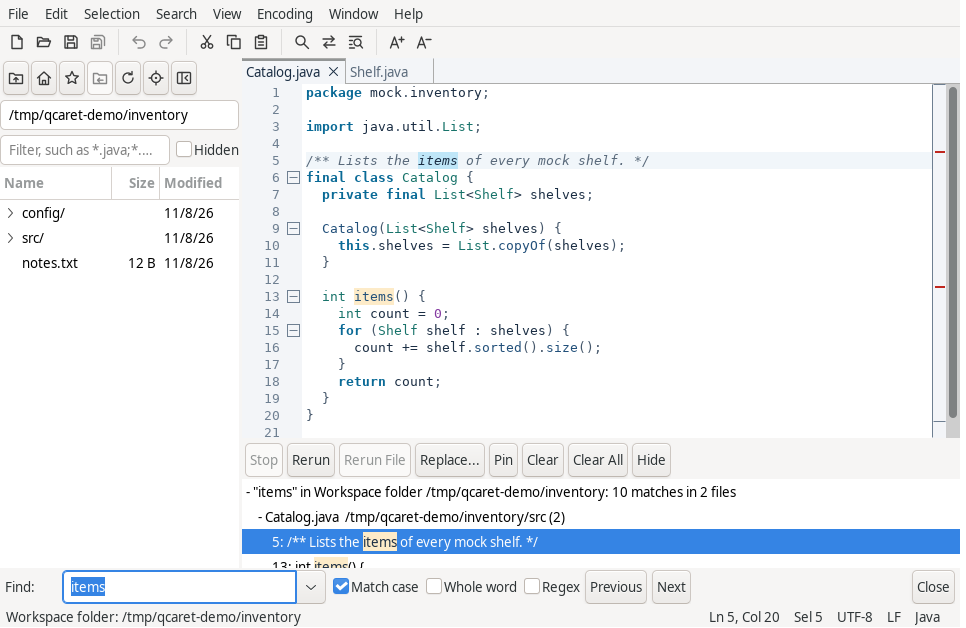

- The toolbar under the menu bar holds New, Open, Save, Save All, Undo, Redo,
  Cut, Copy, Paste, Find, Replace, HyperSearch, Zoom In and Zoom Out. Each button
  runs its menu command, and its tool tip names the keys. Undo and Redo are
  available when the document has a step to take, Cut and Copy with a selection;
  the keys work the same in the find bar and in dialogs. View > Toolbar hides it
  in every window, and the choice is saved. In a narrow window the last buttons
  leave the row; the menus hold the same commands.
- Common menu items show an icon on Linux and Windows, the same one as their
  toolbar button. macOS menus show none.
- The title bar shows the selected document's name, a `*` while it has unsaved
  changes, and its path.
- The tab row holds one tab per document. A dirty document's tab is marked, and
  so is a file missing on disk. A middle click or the close button closes a tab;
  dragging moves it. A tab's menu offers Close, Close Others, Close to the Left,
  Close to the Right, Close All, Copy Full Path, Copy File Name, Open
  Containing Folder and Move to New Window, for that tab. File > Close Multiple
  Tabs runs Close Others, Close to the Left and Close to the Right on the
  selected tab.
- Three buttons end the tab row. `+` opens a new document and `x` closes the
  selected one, asking first about unsaved changes. The arrow between them
  lists every tab, with the number of tabs that do not fit in the row beside
  it; separators set the tabs shown in the row apart from the others, and the
  selected one is checked. Choosing a tab selects it and brings it into the
  row. The mouse wheel over the row scrolls it one tab at a time and keeps the
  selected tab in view.
- Closing a window's last tab opens an empty Untitled document in its place. An
  empty Untitled document with no unsaved changes stays open when it is the
  only tab. Preferences, Files, "Close the window with its last tab" closes the
  window instead; with the last window, QCaret quits as File > Exit (`Ctrl+Q`;
  Quit in the application menu on macOS) does. A tab dragged or moved to
  another window leaves its window empty.
- The editor shows line numbers, bookmark and fold marks in its gutter. View >
  Word Wrap, Show Whitespace, Show Line Endings, Overview Strip and Line Numbers
  apply to the window's editors. Zoom is `Ctrl+=`, `Ctrl+-` and `Ctrl+0`.

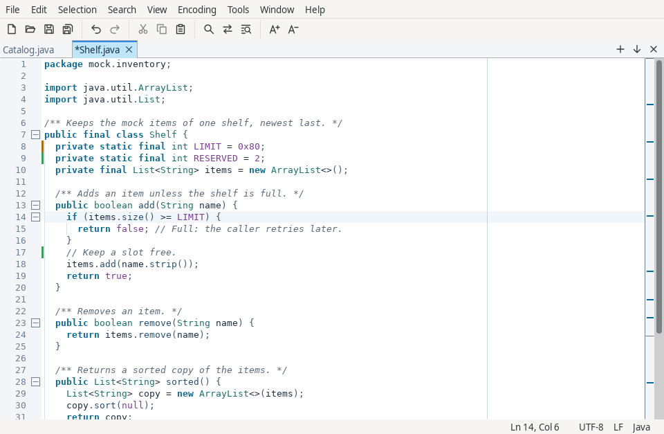

- View > Right Margin draws a line after column 80 in every editor, also with
  word wrap on; Preferences, Editor sets another column. The choice is saved.
- View > Indent Guides draws a faint line at each indent level of a line's
  leading spaces and tabs, at the document's tab width. A blank line carries the
  guides of the lines around it; a wrapped line's later rows have none.
- View > Modified Line Marks marks, right of the gutter, the lines added (green)
  or changed (amber) since the file was opened, saved or reloaded, and a red
  triangle where lines were removed. A document restored after a crash is
  marked against its file on disk. Saving clears the marks, and so does
  undoing back to the saved text. A document or saved text over 100,000 lines
  shows no marks; the gutter's tooltip says so. Both choices are saved.
- Edit > Line > Wrap Paragraph rewraps the selected lines, or the paragraph at
  the caret, to the right margin column. Every line keeps the first line's
  indent, and a comment paragraph keeps its comment marker, such as `//` or
  `#`. A blank line ends a paragraph. Undo restores the text in one step.
- A right click in the text opens Undo, Redo, Cut, Copy, Paste, Select All,
  Toggle Bookmark, Edit Bookmark Comment and Toggle Fold for that view. A click
  in a selection keeps it; a click elsewhere moves the caret there first.
- The overview strip beside the scroll bar marks find matches, HyperSearch
  matches and bookmarks across the whole document; a click or drag scrolls
  there.
- View > Split shows a document in two views, side by side or one above the
  other, each with its own carets and scroll position. `F6` moves between them.
- View > Workspace Browser, Search > Search Results and Search > Bookmarks >
  Bookmarks List show the docks around the editor.
- The status bar shows notices, the read-only marker, line and column, the
  selection, encoding, line endings and language. A click on the language
  chooses a grammar. A Warnings link appears when QCaret logs a warning and opens
  Help > Show Log.
- View > Theme chooses Light, Dark or System. On Windows native controls change
  at the next start; under Dark, dialogs are dark while the main window's docks,
  fields and toolbar stay light. On macOS they follow the system appearance, also
  while QCaret runs. On Linux a GTK theme with no dark variant keeps native
  controls light; the editor and tabs still change.
- Editor colors, on the Editor tab of Tools > Preferences, colors the editors,
  the tab strip, comparison windows and the replace preview, as a terminal
  profile colors only its text area; see [Editor colors](#editor-colors). Menus,
  docks, dialogs and title bars keep following View > Theme.
- View > Command Palette (`Ctrl+Shift+P`) finds and runs any menu command by
  name.

## Editing

Undo (`Ctrl+Z`) and Redo (`Ctrl+Shift+Z`, and `Ctrl+Y` off macOS) restore every
caret. Typing an opening bracket or quote inserts its closer; the grammar names
the pairs, and Preferences turns this off. Enter and a typed closer indent from
the grammar's rules.

| Keys | Action |
|---|---|
| `Ctrl+D` | Duplicate the selection, or the line |
| `Ctrl+Shift+L` | Delete the line |
| `Alt+Up`, `Alt+Down` | Move the lines up or down |
| `Ctrl+J` | Join lines |
| `Ctrl+Shift+U`, `Ctrl+U` | Upper case, lower case (Edit > Convert Case only on Linux) |
| `Ctrl+Backspace`, `Ctrl+Delete` (`Option` on macOS) | Delete the word before or after each caret |
| `Ctrl+T` (`Control+T` on macOS) | Transpose: swap the characters around each caret, or rotate the texts of two or more selections |
| `Ctrl+]`, `Ctrl+[`, `Shift+Tab` | Indent, outdent |
| `Ctrl+/`, `Ctrl+Shift+/` | Toggle a line or block comment |
| `Ctrl+Space` (`Option+Esc` on macOS) | Complete the word from the open documents |
| `Ctrl+B`, `Ctrl+Shift+B` | Go or select to the matching bracket |
| `Ctrl+G` (`Cmd+L` on macOS) | Go to a line, as `line`, `line:column` or `line,column` |
| `Alt+Left`, `Alt+Right` (`Control+Cmd+Left` and `Right` on macOS) | Go Back and Go Forward through jumps, across documents |

Edit > Sort Lines, and Remove Duplicate Lines and Trim Trailing Whitespace in
Edit > Line, act on the selected lines, or every line. Each is one undo step,
and `Esc` stops one still computing, as it stops a running comparison. In a
file mixing CR and LF line endings, these commands, Delete Line, Move Lines,
Transpose and the trim at Save leave alone any line whose change would merge a CR and an LF
into one CR LF line ending, and the status bar names how many lines they left.
Edit > Tab Width (any width from 1 to 16 through Other), Indent with Spaces and
Read-Only apply to the selected document. Preferences, Editor sets the width
and the indentation a document without saved settings starts with. The bracket
beside the caret and the other occurrences of the word at the caret are
highlighted.

Completion opens on its key, or by itself after the number of word chars set in
Preferences. Up, Down, Enter, Tab and `Esc` work in the list; typing narrows it.

Edit > Convert Case > Title Case capitalizes each word of the selections, or
the word at each caret; Swap Case swaps upper and lower case.

Edit > Insert Date and Time lists formats with the current time in each:
the one set in Preferences, Editor (a Java `DateTimeFormatter` pattern such as
`yyyy-MM-dd HH:mm`) first, the format used last selected. The chosen one
replaces every selection, as one undo step.

Tools > Document Statistics shows the selected document's lines, words,
characters, characters without spaces and bytes in its encoding, and the same
for the selections. A word is a run of characters that are not spaces, tabs or
line breaks; a character is a Unicode code point, so an emoji counts once. A
large document shows the percent counted; Refresh counts again after an edit.
In an encoding that can only be read, such as `x-JISAutoDetect`, bytes show as
unknown.

## Multiple carets and block selection

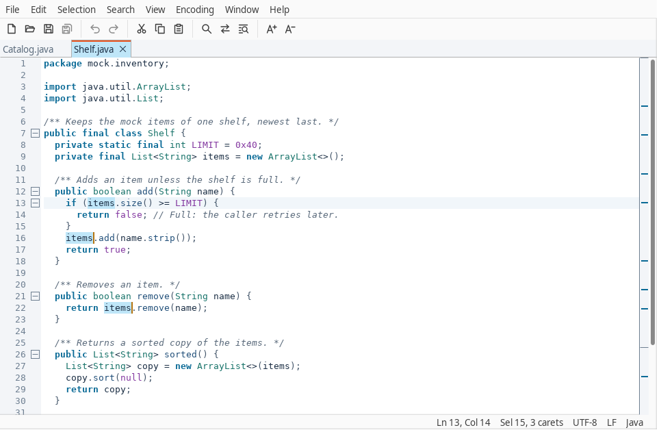

| Keys | Action |
|---|---|
| `Ctrl`+click (`Cmd` on macOS) | Add a caret, or remove the one clicked |
| `Ctrl`+drag (`Cmd` on macOS) | Add a selection |
| `Ctrl+Shift+Up`, `Ctrl+Shift+Down` (`Control+Shift` on macOS) | Add a caret above or below |
| `Ctrl+E` | Select the word, then add its next occurrence |
| `Ctrl+K` | Skip Occurrence: drop the occurrence added last and select the next one |
| `Alt+Enter` | Select every occurrence of the selection, or of the word at the caret |
| `Ctrl+Shift+Space` | Expand Selection: word, quotes, brackets, line, then the whole text |
| `Ctrl+L` (`Control+L` on macOS) | Select the line; again to add the next line |
| Selection > Split into Lines | One selection per line of each selection |
| `Alt`+drag, `Ctrl+Alt`+drag | Select a block |
| `Alt+Shift`+arrow (`Cmd+Option+Shift` on macOS) | Extend a block by one row or column |
| `Alt+Shift`+click | Extend a block to the point clicked |
| `Esc` | Drop the extra carets or the block |

Typing, Backspace, Delete, caret moves and the Edit commands apply at every
caret. Copy joins the selections with the line ending. Paste with as many lines
as selections puts one line at each. A block can reach past the end of a short
line, and typing there pads the line.

Selection > Column Selection Mode makes a plain drag and `Shift` with an arrow
key select a block.

Selection > Undo Selection and Redo Selection step back and forward through the
caret and selection changes of the view, up to 100, without changing the text.
An edit starts the history again. Select All Occurrences selects nothing past
10,000 occurrences. Occurrences that touch, such as `ab` twice in `abab`, stay
separate selections.

## Search and HyperSearch

### Find bar

Search > Find (`Ctrl+F`) opens the find bar, with a selection on one line as
its text. Typing finds as you type and every match in view is highlighted. `F3`
and `Shift+F3` (also `Cmd+G` and `Cmd+Shift+G` on macOS), or Enter and
`Shift+Enter` in the bar, move between matches and wrap at the ends with a
notice. Match case, Whole word and Regex are toggles. `Esc` closes the bar.
Both fields keep a history.

### HyperSearch

Search > HyperSearch (`Ctrl+Shift+F`) finds every match in a scope and lists them
in the results dock while you work.

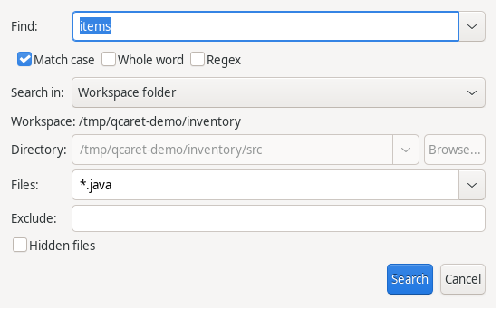

| Search in | Reads |
|---|---|
| Current document, Selection | The selected document, or the view's selections |
| Open documents | Every document open in the window |
| Workspace folder | The window's workspace folder and its subdirectories |
| Directory | The files of one directory |
| Directory and subdirectories | A directory's tree |

Files and Exclude take masks separated by `;`, such as `*.java;*.xml`. Open
documents are searched as edited, in every scope, so a folder search reads an
unsaved buffer and not its file.

### Search results

The dock keeps ten sets, newest first; Pin keeps one past that. A set stops at
100,000 matches. Files over 64 MiB, binary and unreadable files and very long
lines are skipped, and the set's row counts them. Enter or a double click opens
a match; `F4` and `Shift+F4` step through the set. Stop ends a running search
and keeps what it found; Rerun runs it again; Clear and Clear All drop sets.

A match in text changed since the search shows as stale. Opening one goes to its
line with a notice. Rerun File searches that file again.

## Replace

In the find bar, Search > Replace (`Ctrl+H`, `Cmd+Option+F` on macOS) adds the
replace row. Replace and Replace All are one undo step each. A regex
replacement can name groups with `$1` or `${name}`.

Across files, use the dock's Replace or Search > Replace in Results
(`Ctrl+Shift+H`) on a finished set.

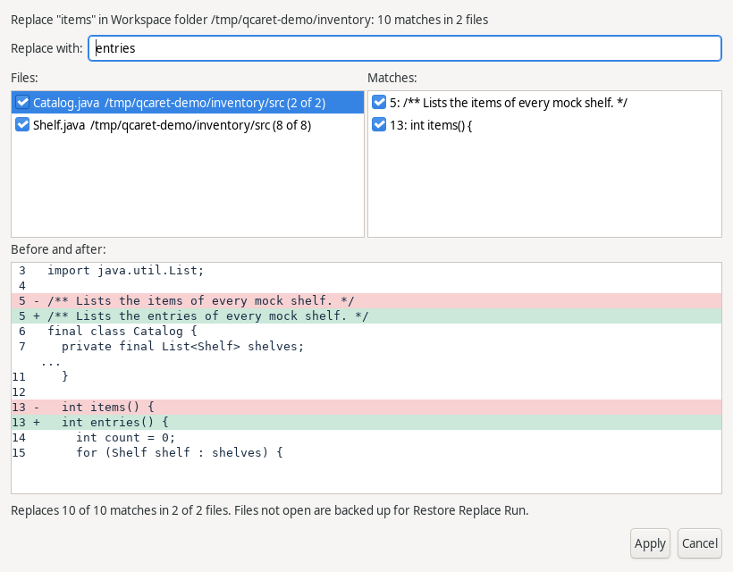

The preview lists every file and match with a check box and shows the selected
file before and after. Apply runs the replacement and opens a report of each
file: replaced, skipped with the reason, failed, or not attempted.

- An open document takes the replacement as one undo step and stays unsaved.
- A file not open is rewritten, with its original bytes kept under
  `replace-backups/` in the settings directory for 7 days.
- A file changed since the search is skipped.

No undo spans files. Restore Run in the report, or Search > Restore Replace Run,
writes a run's backups back, and refuses a file changed since the run. A file
whose write failed partway keeps its backup, and Restore Run puts the original
back.

## Bookmarks

| Keys | Action |
|---|---|
| `Ctrl+F2` | Toggle a bookmark on each caret's line |
| `F2`, `Shift+F2` | Next and previous bookmark, wrapping |
| `Ctrl+Shift+F2` | Edit the line's comment, bookmarking the line |

A bookmark shows as a bar in the gutter and a commented one as a flag, with the
comment as its tooltip. Bookmarks follow their lines through edits. Search >
Bookmarks > Bookmarks List shows the document's bookmarks with Go To, Edit
Comment and Remove. A document holds up to 1,000 comments of 1,000 chars.

## Folding

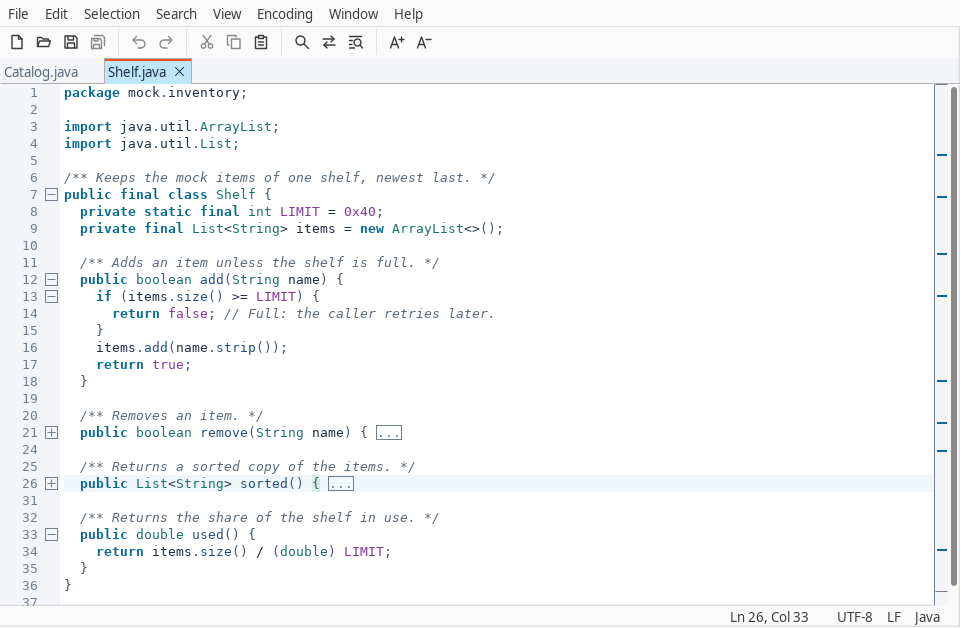

A box in the gutter marks each line that starts a fold region; a click toggles
it. A collapsed region's first line ends in a box with an ellipsis. Regions come
from the grammar's brackets, block keywords or section headers, such as
Markdown headings, TOML tables, INI sections, Dockerfile stages and diff files
and hunks, and from indentation otherwise. Multi-line comments and strings fold
in every language, as do Markdown code fences and region markers: `#region` in
C# and VB.NET, `#pragma region` in C and C++, `// #region` in JavaScript,
TypeScript, Java and Kotlin, each closed by its `endregion` line.

| Keys | Action |
|---|---|
| `Ctrl+Shift+[`, `Ctrl+Shift+]` | Fold, unfold |
| `Ctrl+Alt+[`, `Ctrl+Alt+]` | Fold all, unfold all |
| View > Folding > Toggle Fold | Either, at the caret |

An edit inside a collapsed region expands it. A command that puts the caret in
hidden lines, such as find or Go to Line, expands the regions hiding it. Each
split view folds on its own.

## Syntax highlighting

QCaret highlights 35 languages and 12 file formats:

| Kind | Grammars |
|---|---|
| Languages | Plain Text, Java, XML, HTML (with embedded JavaScript and CSS), JSON, YAML, SQL, Python, JavaScript, TypeScript, C, C++, Shell Script, PowerShell, Windows Batch, Properties, INI, CSS, Markdown, Go, Rust, C#, Kotlin, Ruby, PHP, Perl, Lua, Groovy, Scala, Swift, Dart, R, Haskell, Objective-C, VB.NET |
| File formats | Dockerfile, Makefile, CMake, TOML, diff and patch, CSV and TSV (one color per column), log files (levels, timestamps, stack traces), HCL and Terraform, Protocol Buffers, GraphQL, nginx configuration |

The grammar follows the file name, its extension or its first line (a shebang,
`<?xml`, `<!DOCTYPE html>`). View > Syntax, or a click on the status bar's
language, chooses another one for the document, from the last five chosen or a
category submenu. A line over 10,000 chars shows without colors; Preferences
changes that limit. Edit > Toggle Line Comment and Toggle Block Comment use the
grammar's comment delimiters.

User grammars are XML files in `grammars/` in the settings directory, read at
startup. One with a built-in grammar's id replaces it, and its `category`
attribute picks its Syntax submenu (User without one). View > Syntax > Reload
Grammars reads them again, and an invalid file is skipped with a notice. The
format is in the project documentation, `qcaret-core/docs/grammars.md`.

## External changes

QCaret checks each open file every 5 seconds and when a window activates.

| The file on disk | Without unsaved changes | With unsaved changes |
|---|---|---|
| Changed | Reloads | Asks: Keep Mine, Reload or Compare |
| Deleted | Stays open, unsaved, marked missing | Same |
| Back with the same bytes | The mark clears | The mark clears |

QCaret waits until the file stops changing, for up to half a second, so one
write by another program asks once. A reload is one undo step and keeps each
view's caret line and column. It reads the file as an open does, so a file
another program converted shows its new encoding; a charset chosen with Reopen
with Encoding stays. Text typed during a reload stays, and QCaret asks. When the
change does not fit in memory or the file cannot be read as text, the tab keeps
its text and a notice shows once per change. Keep Mine makes the next save ask.
A save that finds the file changed asks: Overwrite, Reload, Compare or Cancel.
Preferences, Files sets the interval and can make a clean document ask too.

## Workspace

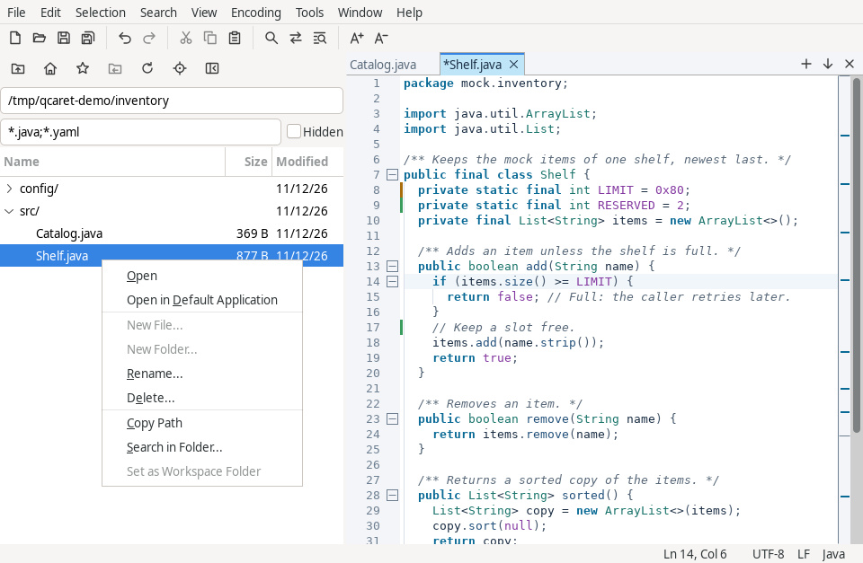

File > Set Workspace Folder gives each window one folder, the scope of
HyperSearch's Workspace folder and of Quick Open's file list. View > Workspace
Browser shows its tree. Enter or a double click opens a file, and so does
dragging it onto the editor, the tabs or anywhere on a QCaret window; a drag to
another program copies the file. Hover over a row for its full path, size and
modified date and time. The icons above the tree show their names when you
hover over them. Tab reaches each icon and Space runs it. Refresh lists the folder
again, Reveal Active File selects the current document's file, and Hide Browser
hides the browser. A row's menu offers Open, Open in Default Application, New
File, New Folder, Rename, Delete, Copy Path, Search in Folder and Set as
Workspace Folder; right-click empty space in the browser to act on the shown
folder itself. Open in Default Application refuses a file the system would run.

Ctrl-click (Cmd-click on macOS) adds or removes a row, and Shift-click selects
a range. With several rows selected, Open, Open in Default Application and
dragging take every selected file (on GTK 4 a drag takes only the row pressed),
and Open in Default Application asks first for more than 10 files; Copy Path
copies every path, one per line; Delete deletes every selected file and folder
after one prompt. New File, New Folder, Set as Workspace Folder and Enter act
on the row you clicked last. Search in Folder and Rename take one row.

The browser can show any folder without changing the workspace folder, which
stays the scope of Quick Open and HyperSearch. The path field shows the shown
folder; hover over it to see whether that is the workspace folder. Type a path
there and press Enter: a path relative to the shown folder, or `~` for your home
folder. Parent Folder and Home Folder move up and home; Workspace Folder shows
the workspace folder again. Favorites lists your favorite folders and adds or
removes the shown one. The filter field takes patterns such as `*.java;*.md`
and applies to files, not folders; it ignores case on Windows and macOS. Hidden
lists hidden entries. The Modified column shows the date; the row's tool tip
adds the time. Click a column header to sort by name, size or modified time,
and again to reverse. Each window keeps its shown folder, filter and Hidden
setting in the session. A change made in one window's browser shows in every
window's.

| Command | Effect |
|---|---|
| Search in Folder | Opens HyperSearch on the folder and its subdirectories, or on a file's folder; press Search to run it |
| New File, New Folder | Asks a name and creates the entry in the folder; a new file opens in a tab |
| Rename (F2) | Asks a new name in the same folder; open documents under it follow with their unsaved changes |
| Delete (Delete key) | Asks first, naming what goes and how many files and folders a folder holds, then deletes permanently: there is no trash and no undo |

A name must be a single file or folder name, and a name already in use is
refused. A link is renamed or deleted as the link; its target stays. Open
documents under a deleted entry stay open, marked missing, and Save writes them
again. A folder delete that fails partway stops and says what is left. Renaming
the workspace folder or a folder above it moves the workspace folder in every
window; deleting it leaves no workspace folder set. A notice says so.

Hidden entries and the excluded directories (`.git`, `.svn`, `.hg`, `target`,
`node_modules` and `build` by default) stay out of the browser, Quick Open and
folder searches; the browser lists hidden entries with Hidden checked.
Preferences, Search and Workspace changes the list.

## Quick Open

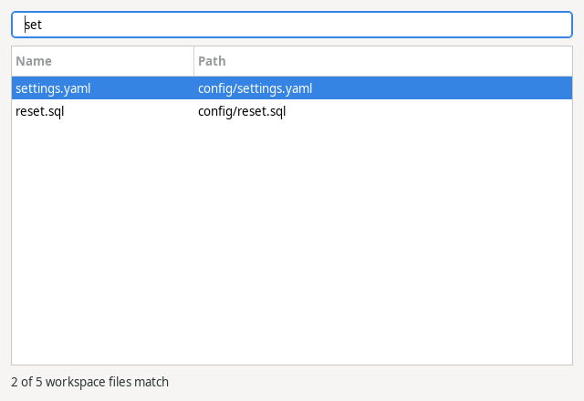

File > Quick Open (`Ctrl+P`) matches a typed name against the open documents, in
bold, then the workspace files, up to 200,000 indexed, then Recent Files. The
query's letters match in order and need not be adjacent. A query ending in
`:line` or `:line:column` opens there. With nothing typed it lists the open
documents and Recent Files. Window > Switch Document (`Ctrl+Shift+O`) is the same
list over the open documents.

Search > Go to Symbol (`Ctrl+R`, `Cmd+R` on macOS) lists the functions, classes,
headings and other definitions of the document, found by its language; typing
narrows the list, and Enter moves the caret to the one selected. In Quick Open,
`@` followed by a name does the same, and `Shop@total` opens `Shop.java` at
`total`. Definitions inside comments and strings are left out. The list of a
document unchanged since it was last shown opens at once; after an edit, the
document is read again from the edited lines.

## Compare

View > Compare > Compare Documents compares the selected document with another
open one; Compare with File on Disk compares it with its file, and so does the
Compare button of a change prompt. `--diff <a> <b>` compares two files from the
command line.

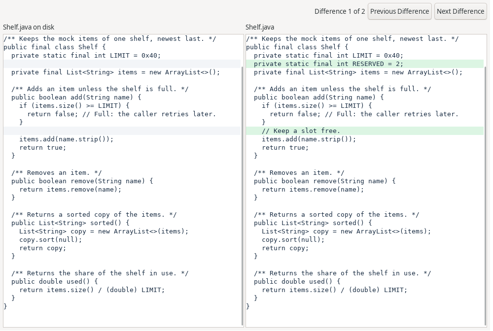

The comparison is a read-only window with the two sides scrolling together. `F7`
and `Shift+F7` step through the differences, and `Esc` closes it. A side over
100,000 lines or 16 Mi chars gets a notice instead.

## Checksums

The Tools menu has a submenu for each of MD5, SHA-1, SHA-256 and SHA-512. MD5
and SHA-1 detect accidental changes only; use SHA-256 or SHA-512 where someone
could alter a file on purpose. An algorithm your Java runtime does not offer
shows disabled, with the reason in its tool tip.

- Generate shows the hash of the text you type, encoded in UTF-8, with Copy.
- Generate from Files hashes the files you choose into a list in the
  `sha256sum` format, `<hash>  <name>`, with a progress bar and Cancel. When
  two files share a name, names include their folders below the common folder,
  such as `a/x.txt`. Copy and Save As take the list; saved in that common
  folder, the list verifies with Verify Checksums.
- Generate from Selection into Clipboard copies the hash of the selected
  text as the document saves it: in the document's encoding, without a byte
  order mark, line breaks as the document holds them. Several selections join
  with the document's line ending, as Copy joins them. The notice shows the
  encoding, the line ending and the hash.

Tools > Verify Checksums checks a `sha256sum`-style list: the selected
document, when it has a file, or a list chosen with Choose List. A line may use
`*` before the name. Names are relative to the list's folder. Each file shows
OK, FAILED, MISSING or unreadable, lines that are not checksum lines are listed,
and the totals end the list. Lines may end in LF, CR LF or CR, and a chosen
list may start with a UTF-8 byte order mark.

## Sessions and recovery

A start without files restores the last session: every window at its position,
with its tabs, carets, scroll, splits, folds, bookmarks, read-only state, view
options, workspace and dock contents. A file that does not open is named and
skipped. Search results return as requests, and Rerun fills them. A closed file
keeps its caret, tab settings, encoding and grammar for when it opens again.

While a document has unsaved changes, QCaret writes it to `recovery/` in the
settings directory every 30 seconds. After a crash the next start lists those
buffers with the state of each original file:

- Restore opens the buffer with its unsaved changes and leaves the original file
  alone. When the original cannot be read, the next save asks first.
- Discard deletes the recovery file.
- Later keeps it for the next start.

A recovery file that cannot be read is listed as such and kept, and the other
buffers are listed as usual.

Recovery files left by a crash are kept for 30 days. With Preferences, Files,
Quit without asking on, Exit asks nothing and the next start restores unsaved
and untitled buffers. Exit during a restore waits for the restore to end; Cancel
on the load row ends a slow one, and that tab leaves the next session.

## Windows and the running instance

Window > New Window opens another window. Settings, the theme, key bindings,
grammars and Recent Files are shared; each window has its own tabs, find bar,
workspace folder and search results. A document is open in one tab of one window
at a time.

View > Always on Top keeps a window above other applications' windows, with its
dialogs above it; the session restores it per window. It has no default key. On
Linux it needs GTK 3 on X11; under Wayland or GTK 4 the item is disabled, and
the window manager's window menu (`Alt+Space` on most desktops) offers the same.

Drag a tab out of every QCaret window to open it in a new window, or onto another
window's tab strip to dock it there; Window > Move to New Window and the tab
menu do the first. The document moves live and nothing is read again: undo
history, unsaved changes, carets, scroll, folds, bookmarks and its recovery file
go with it. A tab with a save, reload or conversion running does not move.
Search results stay in their window and still lead to the moved tab.

File > Exit (Quit in the application menu on macOS) asks about unsaved documents
in every window before anything closes; Cancel leaves everything as it was, and
a save that fails stops the quit. Closing a window asks about its own documents;
closing the last one quits. A document edited while its save from a close
prompt runs stays open and asks again.

A second launch on the same settings directory passes its files to the running
QCaret and exits. They open in the window activated last, or a new one with `-n`.
Launches at the same moment queue, and each file becomes a tab in the one
instance. `-m` runs an independent instance that saves no window placement or
session. One instance at a time keeps the session: a launch that cannot hand
its files over while another instance keeps it opens a window without the
session and saves none. QCaret refuses to open or replace `instance.lock` in
the settings folder, the file that identifies the running instance,
`qcaret_session.lock`, held by the instance that keeps the session, and each
`owner.lock` it holds under `recovery`.

File associations: on Linux run `bin/install-desktop-entry`; on Windows run
`register-associations.cmd`; the macOS bundle declares its document types itself.

## Preferences

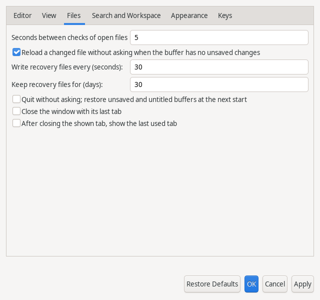

Tools > Preferences (`Ctrl+,`; the application menu on macOS) applies to the
running windows without a restart.

| Tab | Holds |
|---|---|
| Editor | Completion trigger, auto-close, longest line with syntax colors, tab width and spaces for new documents, right margin column, date and time format, `.editorconfig` files and modelines on or off, editor colors |
| Files | Seconds between file checks, reload without asking, recovery interval and keep time, quit without asking, close the window with its last tab |
| Search and Workspace | Longest line searched, days a replace run's backups are kept, excluded directories, Clear History |
| Appearance | Theme, editor font size, editor font |
| Keys | Every command's keys: Add, Remove, Default Keys |

Add refuses a key that types text or that another command holds, and names that
command. Clear History removes the saved search texts, replacements, directories
and masks, and the searches kept in the session. When another QCaret window owns
the session, its saved searches stay and a notice says so: close that window,
then press Clear History again.

### Editor font

Editor font lists the installed monospace families, filled in a moment after the
dialog opens; columns need letters of equal width, so proportional fonts are not
offered. Only TrueType and OpenType files in the system and user font folders
are listed, and only families the platform reports as installed. If the chosen
family is uninstalled, QCaret logs a warning and uses the platform's font until
it returns. The font applies to every editor, the
comparison windows, the replace preview and the log and license windows.

### Editor colors

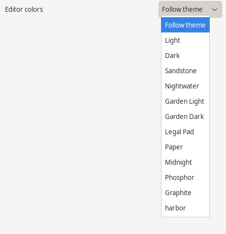

Editor colors lists Follow theme (the default), Light, Dark, the bundled schemes
and then your theme files. A choice applies at once.

| Choice | Colors |
|---|---|
| Follow theme | Light or Dark, as View > Theme resolves |
| Light, Dark | Navy text on white; light text on navy |
| Sandstone, Nightwater | Muted accents on warm cream; the same accents on deep teal |
| Garden Light, Garden Dark | Clear accents on light gray; bright accents on charcoal |
| Legal Pad | Black on light yellow |
| Paper | Black on white |
| Midnight | White on black |
| Phosphor | Green on black |
| Graphite | Gray on black |

Every scheme keeps syntax colors at a contrast ratio of at least 4.5 to 1 on
the background, the current line and the find and bracket highlights.

### Theme files

A theme file changes colors of Light or Dark. Put a file named `<name>.theme` in
the `themes` folder of the settings directory, then choose it under Editor
colors. Its `light.*` lines apply while View > Theme resolves to light and its
`dark.*` lines while it resolves to dark, as Follow theme does. To see an edit
to the chosen file, press Apply. A name holds letters, digits, `.`, `_` and
`-`, and a file is at most 64 KiB; a file named like a scheme, such as
`paper.theme`, is not listed.

```text
# Harbor. A line starting with # is a comment.
light.background = #FDFBF5
light.currentLine = #F3EFE3
light.token.keyword = #7A3E9D
light.token.comment = #6B7B5E
dark.background = #10202E
dark.gutter = #0C1924
dark.token.string = #E6C07B
```

Each line is `light.<color> = #RRGGBB` or `dark.<color> = #RRGGBB`. A color left
out keeps its built-in value. A value that is not `#RRGGBB` logs one warning and
keeps the built-in value; a key QCaret does not know is ignored.

| Color | Paints |
|---|---|
| `text`, `background` | Plain text and the view behind it |
| `selection`, `selectionText` | Selected text's background and text |
| `currentLine` | The caret line's background |
| `lineNumbers`, `gutter` | Line numbers and the gutter; `gutter` also colors the tab strip |
| `caret`, `whitespace` | Carets and whitespace marks |
| `findMatch`, `occurrence`, `bracket` | Backgrounds of a find match, the word at the caret, a matching bracket |
| `tabText` | An unselected tab's label |
| `overviewFind`, `overviewSearch` | Overview strip marks of a find match and a HyperSearch match |
| `bookmarkComment` | The gutter mark of a bookmark with a comment |
| `diffRemoved`, `diffAdded`, `diffChanged` | Comparison window line backgrounds |
| `rightMargin` | The right margin line |
| `indentGuide` | Indent guides |
| `lineAdded`, `lineChanged`, `lineRemoved` | Modified-line marks of an added line, a changed line and removed lines |
| `token.<role>` | Syntax colors; the role is `comment`, `string`, `escape`, `keyword`, `keyword2`, `type`, `number`, `constant`, `operator`, `delimiter`, `function`, `preprocessor`, `tag`, `attribute`, `heading`, `emphasis`, `link` or `invalid` |

A theme file sets colors only: bold, italic and underline stay as built in.

### Settings directory

Settings are in `qcaret.conf`, in the first of these that applies:

| Mode | When | Directory |
|---|---|---|
| Explicit | `--settings <dir>` | `<dir>` |
| Portable | `qcaret.conf` exists in the installation directory | The installation directory |
| Per-user | Otherwise | Linux `~/.config/qcaret`, Windows `%APPDATA%\QCaret`, macOS `~/Library/Application Support/QCaret` |

In explicit and portable mode on Linux, User Guide opens the guide in the
system's HTML application instead of its own window, because the embedded
browser writes under `~/.cache` and `~/.local/share`. The one write left outside
the settings directory is an empty `~/.config/ibus/bus`, which the GTK input
method module creates.

When Preferences or Clear History finds `qcaret.conf` unreadable or not valid,
the running settings stay and a notice says so once per run. The next save
first copies the file to `qcaret.conf.invalid` in the same directory.

## Help and logs

- User Guide shows this guide in a window that loads nothing else: a copy of
  the page written to the settings directory, holding its own images, with
  JavaScript off. Under GTK 4 a
  notice names the guide's file instead; open that file in a browser. Without a
  working embedded browser, and in explicit and portable mode on Linux, the
  guide opens in the system's HTML application, else a notice names the file.
- Keyboard Shortcuts (`F1`) lists every key, with a filter and Copy.
- Command-Line Options shows the usage text.
- Tip of the Day shows a short tip about a feature, with its menu path and
  key. Next Tip shows the next one, and the next show, in any window,
  continues the list. Show tips on startup opens it at each start, after the
  session has restored and the recovery prompt, if any, is answered. It is off
  by default.
- Show Log shows the recent log lines and clears the Warnings link.
- Debug Log File writes the log at DEBUG to `logs/` in the settings directory
  until turned off. Open Log Folder and Open Settings Folder open those folders.
- Report an Issue copies the About details to the clipboard and opens the
  project's issue page in the system browser. Together with the project link in
  About, it is the only web address QCaret opens, and only when you pick it.
- About shows the version, runtime and settings directory; Licenses shows the
  license notices and Copy Details copies the details.

## Command line

```text
qcaret [options] [[+<line>[:<column>]] file]...
```

| Option | Effect |
|---|---|
| `-h`, `--help` | Print usage and exit |
| `-v`, `--version` | Print the version and exit |
| `-d`, `--debug <level>` | Log level on stderr: `1` info, `2` debug, `3` trace, or a level name |
| `-l`, `--log` | Also write the log to `logs/` in the settings directory, for this run |
| `-m`, `--multi` | Run as an independent instance |
| `-n`, `--new-window` | Open in a new window of the running instance |
| `-r`, `--read-only` | Open the following files read-only |
| `-e`, `--encoding <name>` | Open the following files in this encoding |
| `+<line>[:<column>]` | Place the caret in the next file |
| `--session`, `--no-session` | Restore the previous session also with files, or skip it |
| `--diff <a> <b>` | Open the comparison of two files |
| `--window-width <px>`, `--window-height <px>` | Client-area size, for this run |
| `--window-x <px>`, `--window-y <px>` | Window position, for this run |
| `--settings <dir>` | Settings directory |
| `--` | End of options |

A missing file opens an empty document that saves to that path. Options combine:
`-ml`, `--opt=value`, `-d2`. An unknown option or a bad value exits 1; an SWT
start failure, such as missing GTK libraries, exits 3.

```text
qcaret +120:8 src/Mock.java -r notes.txt
```

To give QCaret more heap for large files, see [Large files](#large-files).
